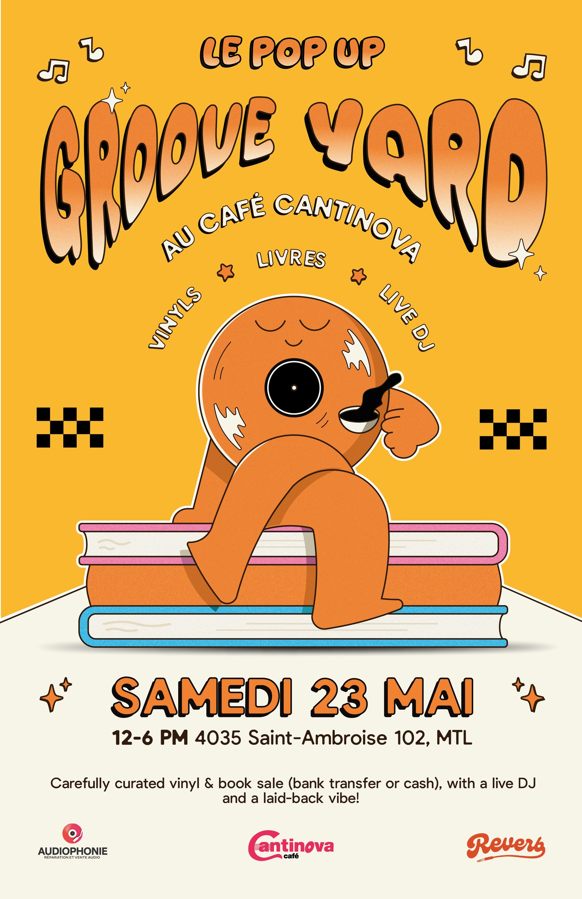

# ULJO — portfolio

Static site. No build step, no dependencies. Open `index.html`, or serve the folder.

```bash
python3 -m http.server 4931 --directory ~/uljo-portfolio
```

Then visit http://localhost:4931

## Files

| path | what it is |
|---|---|
| `index.html` | the home page — one section per block of the Figma frame |
| `easy-checkout.html` | the Easy-Checkout case study |
| `about.html` | About me — the eclipse, Music, the stream, Desiderium |
| `contact.html` | Contact — the white card and the note |
| `system.html` | the design system, as a reference sheet |
| `assets/css/system.css` | the design system: tokens, the bar, the new pages |
| `assets/js/about.js` | About me: stars, the eclipse shader, Music, the stream, the player |
| `assets/css/style.css` | all styling; tokens at the top |
| `assets/js/main.js` | carousels + project-card dashes |
| `assets/img/` | the artwork, resized and compressed for the web |
| `assets/video/` | the case-study clips, transcoded to 720p H.264 |

## How the sizing works

The Figma frame is **1280 px** wide. Every value in the CSS is the measured
design value written as `rem`, where **1rem = 16px at 1280**:

```css
html { font-size: clamp(10px, 1.25vw, 20px); }  /* 1.25vw = 16px at 1280 */
body { max-width: 1600px; }                      /* 1600 = 1280 × 1.25 */
```

So the page is pixel-exact at 1280 and scales as one system between roughly
800 and 1600 px. Below 900 px a breakpoint takes over and stacks the columns.

Two container widths recur, both taken from the design:

- `--w-wide` **98.125%** (1256 px) — hero, about, Underground Lab, project cards
- `--w-narrow` **86.72%** (1110 px) — the four feature rows and the footer

## Type scale (design px at 1280)

| element | size | notes |
|---|---|---|
| nav | 26 | |
| hero headline | 62 / lh 67 | mixed weight: bold + regular |
| hero meta | 25 | italic |
| name "Jaime Olivares" | 67 | bold, one line |
| role | 35 | |
| about body | 26 / lh 28 | |
| "Welcome, to the" | 65 | hangs 57 px left of the wordmark |
| "Underground Lab" | 103 | extra-bold italic |
| project card title | 36 | bold |
| project card subtitle | 25 | |
| feature heading | 66 | |
| feature body | 27 / lh 38 | sized to keep the design's line breaks |
| quote | 48 / lh 59 | bold |
| footer heading | 60 | bold |
| footer email | 38 | |
| buttons | 26 | pill, 100 px tall, radius 50 |
| Collaborate button | 36 | 185 px tall, full width |

Font stack is `"SF Pro Display", "SF Pro Text", -apple-system, …`. On a Mac
that resolves to real SF Pro. **For a public deploy you'll want a licensed
web font** — Apple's SF fonts aren't licensed for general web use. Inter is
the closest free substitute and is already in the fallback chain.

## Corner radii

Set once as tokens, so they stay consistent:

| token | px | used by |
|---|---|---|
| `--r-card` | 75 | project blocks |
| `--r-card-media` | 63 | image inside a project block (= 75 − 12 padding) |
| `--r-about` | 120 | the Jaime Olivares block |
| `--r-about-media` | 95 | the portrait inside it (= 120 − 25 padding) |
| `--r-plate` | 48 | hero (top corners only), Underground Lab |

The inner radii are the outer radius minus the padding, so the corners stay
concentric. Change the outer one and the inner should follow.

## Images

Sources live in `~/Desktop/ULJO/`; `assets/img/` holds web-sized copies
(~1.3 MB total). To regenerate one, resize to the widths below with
`quality=88`, progressive, and flatten transparency onto the right ground:

| file | size | from |
|---|---|---|
| `hero.jpg` | 1600×1656 | `Design System/HeroPage.png`, bottom 20% cropped (it was solid black) |
| `portrait.jpg` | 900×900 | `Design System/Portrait.png` |
| `uljo-logo.png` | 600×347 | `Design System/Uljo_Logo.png`, trimmed to its alpha bounds |
| `easy-checkout.jpg` | 1300×841 | `Easy Checkout/Portfolio images/Hero_Page.png` |
| `poster-0*.jpg` | 1000 wide | `Posters and logos/` |

### Still placeholders

Anything left is a `div.ph` with a `data-ph` label — the Underground Lab
backdrop, the four feature plates, the logo carousel, and the Airbnb / Cycles
Oliver / Stylex cards. Replace the div with an `` when the art exists.
The about card's backdrop is a `--dark` gradient standing in for the blurred
cityscape the Figma shows there.

## The hero

It runs at the artwork's own proportions (2550 × 2640 after the black tail is
cropped) with only its top corners rounded, and the image carries a mask that
dissolves the last 16% into the page — so it ends in black rather than on a
card edge. The `see work` pill is pinned at `top: 42%`, which puts it over the
dark rooftops.

## Carousels

`main.js` builds both from markup:

```html
<section class="carousel" data-carousel="poster" data-count="6"> … </section>
```

`data-carousel` is `poster` (500 × 839) or `logo` (500 × 505).

Plates written into the HTML win. Each is a `<button class="slide">` holding an
``, with `data-caption` for the label under the carousel:

```html
<button class="slide" type="button" data-caption="Groove Yard">
  
</button>
```

If the track is empty, `data-count` generates that many blank plates instead —
that's what the logo carousel still does. The coverflow shows five plates at
once, so with fewer than five the set is repeated around the ring; captions
still report the original artwork.

Both accept:

- horizontal swipe / mouse drag
- trackpad horizontal scroll
- ← → arrow keys when focused
- clicking a side plate to bring it to the centre
- infinite wrap-around

The side plates are trapezoids — outer edge 1.047 × the centre height, inner
edge 0.968 × — dimmed with `filter: brightness()` so real images will dim the
same way. That geometry is measured off the Figma frame.

## Buttons

Every button is clickable and styled for hover/focus, but the hrefs are `#`
anchors or in-page jumps. Nothing navigates away yet.

## Known gaps

- The logo is a PNG. An SVG export would stay crisp at any size — drop it in
  at `assets/img/uljo-logo.svg` and change the one ``.
- Section pages (travels, music, about, archives, meditations, contact) don't
  exist yet — the nav links jump to the matching section on this page.
- No cache-busting on asset URLs. If you deploy and an old CSS file sticks
  around, add `?v=2` to the `<link>` and `<script>` tags.


## The Easy-Checkout page

Copy and type sizes come from `portfolio_reference.fig`. That file's design-system
frame specifies **Headline 68 / Subtitles 37 / Text 28, SF Pro at −7% tracking**,
which is what `.case-title`, `.case-question` and `.case-body` use.

### The embedded prototype

`easy-checkout.net` is framed live at the top of the page. The iframe carries
`pointer-events: none` so the page scrolls straight over it; clicking the veil
adds `.is-live`, which hands the pointer to the prototype. Escape, the release
button, or a click outside gives scrolling back. The site sends no
`X-Frame-Options` or CSP frame directive, so framing it is allowed.

### Scroll-driven video

Any `[data-scrub]` section maps its own scroll progress onto the playhead:

```html
<section class="scrub wide" data-scrub>
  <div class="scrub__sticky">
    <video data-scrub-video muted playsinline preload="auto"> … </video>
  </div>
</section>
```

The section is `260vh` tall with a `100vh` sticky child, so there is `160vh` of
travel to scrub through. Nothing plays on a timer — the reader moves the frames.
Seeks are throttled to one per animation frame.

Videos were transcoded from the 4K originals with the built-in macOS converter
(there is no ffmpeg on this machine):

```bash
avconvert -s "SOURCE.mp4" -p Preset1280x720 -o assets/video/OUT.mp4 --replace
```

Keep them short and small — the whole clip has to be seekable for scrubbing to
feel instant.

## Scroll-in motion

Modelled on vanschneider.com, which animates on `cubic-bezier(.32,.72,0,1)` —
that curve is `--ease-in-view`. Elements fade up 2.25rem over .75s; project
cards get a larger travel plus a slight scale (`.reveal--pop`). Groups and their
stagger are declared in one table in `main.js`, so adding a section to the
sequence is a one-line change.

Classes are added by JS, so if the script fails nothing is left invisible.
`prefers-reduced-motion` skips the whole system.


## Top bar and drawer

The header is `position: sticky; top: 0`. That needs no scrolling ancestor, so
`html` uses `overflow-x: clip` rather than `hidden` — `hidden` creates a scroll
container and silently breaks sticky.

Past 40px of scroll the header gains `.is-stuck`: it frosts, the six links fade
out, and the two-bar button fades in. That button opens `.drawer` — a left panel
at `33.333vw` (78vw on phones) with a scrim, body scroll lock, Escape to close,
and focus returned to the button afterwards. Below 900px the six links are only
ever in the drawer.

## Poster perspective

The side plates are projected, not clipped — the poster artwork itself takes the
angle. Derived from the design's own trapezoid (outer edge 1.047x the centre
height, inner edge 0.968x, projecting to `--side-w` wide):

```
width       = --side-w / cos 55°      →  --side-w x 1.7434
perspective = (width/2) sin 55° / .039 →  --side-w x 18.311
height      = --panel-h x 1.006
```

At the default scale a 467x844 plate paints as exactly 268x878 — the design's
numbers. Change `--persp-ang` and the other two follow from it.

## Project card galleries

`.card__media` carries a `data-gallery` array of `[src, alt]` pairs. Clicking the
image walks forward; the five lines under it are buttons that jump straight to an
index. Everything after the first is preloaded so the swap is instant.

```html
<div class="card__media" data-gallery='[["a.jpg","…"],["b.jpg","…"]]'>
  
</div>
```

## Poster lightbox

Clicking the centre poster opens it large with its note beside it; side posters
just centre. `data-note` on the plate supplies the copy. Arrow keys move between
posters, Escape closes.

The click has to be gated carefully: the carousel re-centres a side plate on
click, rewriting `data-pos` before a listener on the plate itself would run. So
the position is read in the capture phase on the way down, and pointer movement
is tracked so a drag ending on the centre plate doesn't open anything.

## The prototype, without chrome

No buttons. The iframe ignores the pointer so the page scrolls over it; clicking
it hands the pointer across, and clicking away or pressing Escape takes it back.
The trade-off is that there is no longer a visible cue that the frame is
interactive — the prototype's own "Click to start" is doing that work.


## A gotcha worth keeping

`[hidden]{display:none!important}` sits near the top of the stylesheet on
purpose. The UA's `[hidden]` rule has the same specificity as a class, so any
class that sets `display` — `.lightbox{display:grid}`, `.drawer{display:flex}` —
comes later and quietly beats it. The result was a full-screen `position:fixed`
overlay laid over the live page: the cursor read `zoom-out` everywhere and
nothing was clickable.

It survived testing because scripted checks call `.click()` straight on the
element, which skips hit-testing entirely. To catch this class of bug, assert on
`document.elementFromPoint(x, y)` — what the real cursor would actually hit.


## Case-study page, second pass

Layout follows the reference mockup: full-bleed **1920x860** plates throughout,
centred statements between them, and heading/body pairs at 44% / 1fr.

Images are cut to 1920x860 with a cover-crop. Two are upscaled from small
sources embedded in the .fig — `ec-store.jpg` (1024px) and `ec-bench.jpg`
(1000px) — so they are softer than the rest. Replace them with the originals
when you have them.

### The prototype

There is no inline embed any more. The screen-flow video scrubs as you pass it,
and once it reaches the end a **Try prototype** button fades in over the frame.
That opens `easy-checkout.net` full screen — the iframe has no `src` until then,
so nothing loads unless it's asked for. Escape, the Close button, or leaving
full screen all shut it.

`requestFullscreen()` needs a real user gesture. If a browser refuses it, the
shell still covers the whole viewport, so the prototype is usable either way.

### Scroll speed

`.scrub` is `700vh`, giving ~1900px of scroll per second of footage. Change that
one number to retime it.

Neither video carries a `poster` — the earlier one showed the drop-off still
frame before the flow had played.

### Audio walkthrough

The control sits in the bar and rides along when it sticks. It stays disabled
until a track exists; give the `<audio data-audio-track>` a `data-src` (or a
`<source>`) and it becomes a play/pause toggle with an animated meter.

## Poster plates

A side plate now holds the **whole poster, flat, tilted away from you** rather
than a cropped slice. JS gives each one its own geometry from the artwork's real
proportions:

```
cos(angle) = --side-w / W          W = plate height x the poster's ratio
distance   = (W/2) sin(angle) / .039   keeps the design's 1.047 / .968 edges
```

So a 546x844 poster and a 675x844 one both land in the same 268x878 slot,
uncropped, at 60.6° and 66.6° respectively. Plates meet edge to edge — no seam —
and carry the same 12px radius as the lightbox.


## Atmosphere

Two thin canvas layers, both added by JS and both skipped entirely under
`prefers-reduced-motion`:

- **`.fx-fireflies`** at `z-index:-1` — behind the page, above the black. A
  dozen-odd motes drift and pulse; the layer fades in when the Underground Lab
  comes within three-quarters of the viewport and stays lit below it.
- **`.fx-spark`** at `z-index:200`, `pointer-events:none` — a short blue trail
  that follows the pointer and is gone in 220 ms. Mouse only: it is never
  created for touch or coarse pointers.

Everything moves **per second, not per frame** (`dt` clamped at 50 ms). Tie an
effect to frame count and it runs at double speed on a 120 Hz display and
crawls in a throttled tab.

Hover lifts live in one `@media (hover:hover)` block — 1.012 on image plates,
1.025 on buttons, a touch more on nav links.

## Poster plates, third pass

Cover Flow rather than a filmstrip: each neighbour tucks partly behind the plate
in front of it, with `show = 0.62` in `main.js` setting how much of it stays
visible. Plate widths already carry the poster's own ratio, so `object-fit:cover`
never distorts.

## Case-study plates

**1254x840**, with 6px between adjacent images (3px a side). The pair grid needs
`min-width:0` on its items — a grid item's automatic minimum is its content
size, and with `aspect-ratio` set that made the first plate 634px inside a 625px
column.


## Fourth pass

**Case plates are 1920x820** (2.34:1). That is a wider crop than the 1254x840
they replaced, so tall sources lose more height — worth checking `ec-bench` and
`ec-store`, which are also upscaled from ~1000px originals. The project card
keeps its own `card-*` set at 1254x840 so it still shows those images whole.

**Collage gutters** are 8px — 4px of margin per image.

**The animation is never cropped.** `.scrub__frame` now carries the clip's own
16/9 and the video uses `object-fit:contain`. Cropping it to the plate ratio was
cutting the sides off.

**The scrolled bar** is a white pill inset 24px from every edge, logo inverted,
burger bars black. Flow height is still preserved, so nothing jumps.

**The walkthrough control** is a play button plus a label; playing, the button
becomes a waveform and a `0:12 / 3:40` clock appears beside it. It stays
disabled until a track exists — set `data-src` on `<audio data-audio-track>`.

**The prototype offer latches.** It used to appear only above 97% of a 5700px
scroll — a ~170px window that was nearly impossible to hit, which is why the
button felt unclickable. It now appears at 82% and stays.

**The pointer light is a DOM layer**, not a canvas particle. Its transform is
written straight from the `pointermove` handler, so it sits under the cursor
with zero lag; only opacity is transitioned. The canvas keeps the short tail.

**Fireflies**: roughly 30–64 depending on width, and brighter.

**The drawer opens from the right.** Image hovers no longer scale — only
buttons, links and the burger do.


## Fifth pass

**The bar is dark liquid glass**, not white — a floating pill inset 24px, same
blur-and-tint treatment as the intro block.

**Mobile bar** is one row: mark left, walkthrough centred, menu right, all three
on the header's mid-line and held 9px clear of the top edge. The desktop rules
give `.nav-burger` a small fade-offset in its transform, so the mobile rule has
to be written at `.site-header .nav-burger` to outrank it — otherwise the icon
sits ~6px high.

**Project order** is now Easy-Checkout / Cycles Oliver, then Airbnb 2030 /
Stylex. The stagger belongs to the slot, not the project, so the layout rhythm
is unchanged. Cycles Oliver leads with its own hero page.

**Hover colours** come from `data-tint` on each card, handed to CSS as `--tint`:

| project | tint |
|---|---|
| Easy-Checkout | `#3642B8` — sampled off the official Decathlon mark |
| Airbnb 2030 | `#41AB58` |
| Stylex | `#000000`, kept legible with a light border |
| Cycles Oliver | `#D5603F` — sampled from its own hero, since none was given |

## The prototype

It is now embedded directly under the hero, interactive from the first click,
with `allow="autoplay; fullscreen"` — the page drives a `AudioContext`, which a
cross-origin frame will not start without the autoplay grant.

It was never actually broken. Loaded on its own it runs fine: clicking through
takes it to "Simulating item drop off". The problem was reach — it sat behind a
button most of the way down a 700vh scroll section, and before that behind an
invisible click-to-activate layer that swallowed the first click. Both are gone;
"Open full screen" sits under the embed for anyone who wants it larger.


## Sixth pass

**The bar matches Apple's 44px.** The pill keeps its floating inset; the flow
height stays 116 so nothing jumps.

**The mark never moves.** The pill's mid-line sits at y=40 (18px down, 44 tall);
the resting header's is 58. `.logo` carries a −18px lift that the stuck state
removes, and both states inset 44px from the left, so the logo holds the same
screen position at rest, stuck, and back again — verified at 40,44 on desktop
and 35,23 on mobile. Measure this only after the .35s transition has settled;
readings taken sooner catch it mid-move.

**Corner radii** are an iOS-ish scale: `--r-xs` 10 through `--r-xl` 40, with the
component tokens pointing at it. CSS cannot draw true continuous corners, so
this is the closest honest approximation.

**Every horizontal plate is 3:2.** The wheelchair/hand pair is 3:4 portrait,
side by side at every width.

**Embers.** `.quote` gets two counter-drifting radial pools on a 19s/27s cycle
plus an SVG-turbulence grain. The grain needs a radial mask — a tiled texture
with no falloff reads as a hard rectangle over the black.

**The walkthrough button** is a white pill, SF Pro regular, bare play glyph. With
no track it runs a stand-in 3:34 timer so the states can be tried; give
`<audio data-audio-track>` a `data-src` and it drives the real file instead.

**Archives** is gone from both navs, both drawers, and the home page.


## Seventh pass

**Hero in motion.** `hero-city.mp4` (the animated top of the scene, 16:9) sits
over the still, feathered from 72% of its height to transparent so the two
dissolve into each other. Verified numerically: mean RGB difference along the
seam is 14–20/255 — the same scene at the same framing. Both were transcoded
from HEVC to H.264 with `avconvert`; Firefox and much of Windows won't play HEVC.

**The mark is 100×60** at rest and scales in place (×0.4667) into the 44px pill,
`transform-origin: left center`, so it holds 40,44 through the whole transition.

**Nav dots** are a 16-lobe scalloped shape drawn once as an SVG `<symbol>` and
`<use>`d, each `<li>` carrying `--dot`. Hover: scale 1.06, text takes the dot's
colour, no underline. The palette, sampled off the reference strip:

| section | colour |
|---|---|
| travels | `#EC6060` |
| music | `#5FA46B` |
| about | `#8B8B8B` |
| meditations | `#E9E960` |
| contact | `#5B5BE8` (archives' blue, now free) |

**The universe.** The menu is a full-screen panel from the right: "Dive into my
universe.", a pixel sun half off the left edge, five pixel-art planets in the
section colours (about wears rings). Sprites are 24px PNGs generated in PIL and
shown at 4–5× with `image-rendering: pixelated`. Regenerate them from the
script in the session notes if the palette changes.

**Neon cursor.** White now, and speed-driven: `energy += distance/700` per move,
decaying ×0.25/s while moving and ×0.02/s once still (>90ms). That puts full
glow near a real shake (~950px/s) and keeps a slow drift faint. The head is a
DOM layer positioned straight from the `pointermove` handler — no frame of lag
— and only lights from the Underground Lab down.

**Embers to the end.** The quote's glow is now a fixed `.fx-embers` layer that
lights when the quote arrives and stays lit to the footer, drifting on 23s/31s
cycles with masked grain. **The Lab** gets its own slow blue-violet wash over its
lower half.

**Cards** are 710 tall with the button riding the bottom; radii are 70 (cards)
and 120 (the intro block). Card images push in 4.5% on hover over 1.1s.

## Eighth pass

**Less.** The orange is gone everywhere — the quote's ember pools and grain, the
fixed ember layer, the universe's warm wash. The neon cursor is gone too. What
stays behind the page: the blue fireflies and the Lab's blue-violet wash. The
scalloped nav dots are gone; each `<li>` still carries `--dot`, which the hover
colour uses.

**The floating bar** follows the mockup: one 116px liquid-glass pill
(`rgba(38,38,42,.62)` + blur, so it reads grey on black) holding softer pills
for each section — the mark (100×60, 16px padding → 132×90), the walkthrough
on the case page ("Walkthrough", no "Play"), and a 90px round menu button on
the right with two 40×8 bars. Same height as the resting header, so nothing in
the page jumps, and the mark holds x=44, y=40 in both states: at rest the
`.bar__lead` group sits 12px low (`translateY(.75rem)`) to match the floating
bar's 12px top offset. The 44px Apple-height pill from the fifth pass is
superseded.

**Hero.** The still is now the 2560×3584 rooftop render the video was made
from (exported at 1600×2240 as `hero.jpg`); the clip's first frame differs from
its top 16:9 slice by 11.6/255 mean — one image. The old `Hero_Page.png` art
that used to show below the video is gone. Top corners 85px (`--r-hero`).

**Cards.** Radius 85 (`--r-card`, media 73). Lightly frosted:
`rgba(34,34,34,.78)` + `blur(1.5rem)` so the wash behind shows through without
changing the colour. Dashes are 3px, fully rounded. On mobile the card is
content-height (`height:auto`) instead of the fixed 710.

**Carousels.** One plate per gesture. A drag steps once and then ignores
further movement until the pointer lifts (`stepped`); a trackpad swipe — a
burst of `wheel` events lasting as long as the momentum — steps on its first
event and swallows the rest until it has been quiet for 260ms. The logo
carousel's stubbed plates are square (`ratio = 1` when a slide has no art).

**Case page.** The prototype is `--w-wide`, as wide as the plate above, at its
own 1224/792 ratio. Every gap between plates is exactly 4px (`.25rem`) — the
sibling rules are scoped so the right-hand plate of a pair doesn't inherit the
margin and sit 4px low (it did). The Decathlon store plate is a two-image
gallery (`ec-store.jpg`, `ec-staff.jpg`, from `rfid_3/4.png` cropped to 3:2)
with two dashes below, driven by the same code as the project cards
(`.card, .case-gallery` → `[data-gallery]`). One screen animation only — the
sharper `ec-kiosk-anim.mp4` after the fist-click plate; the second scrub and
the "Interface human design" block are gone.

## Ninth pass

**No bar, three pills.** The outer glass pill is gone. The header is a
transparent sticky strip (`pointer-events:none`, so clicks reach the page)
and each element floats as its own dark liquid-glass pill once you scroll:
the mark (75×50 max, 16px padding → 107×68), the walkthrough on the case page,
and a 68px round menu button with two 30×6 bars. Everything is 0.75× the
eighth pass. The mark is centred in the 116px resting header — 33 clear of
the top edge and 33 clear of the hero — and nothing about the header's
geometry changes on scroll, so it holds x=44, y=33 in both states.

**Stars.** Each nav link carries a small four-point star (`.star`, inline SVG,
`fill:currentColor`) so it takes the section colour on hover with the text.

**"See work" is on screen when the page opens**: `top:26%` of the hero puts
its bottom at 673px from the page top at 1280×16 (under 720 even on the
smallest laptop). The intro block follows via `placeIntro()` — still 40px
under the button.

**The Easy-Checkout card** briefly carried the screen animation as its second
image; that was reverted the same day — five stills, five dashes.

**Case page.**
- The bar is hidden when the page opens (`position:fixed`, `opacity:0`, all
  pointer events off) and fades in as the hero plate leaves: opacity =
  distance the plate's bottom edge has travelled past the middle of the
  viewport ÷ half the viewport. Full once the plate is gone. On a case page
  the header is always in its "stuck" state — there is no resting nav.
- **Every project head is the same:** `.case-head` under the hero plate —
  title 67 (`<strong>` for the bold word), year 37 on the right on the same
  baseline, one 37 line below, both in `--muted`. Easy Checkout is dated 2026.
- Plates are 20px from each other and 20px from the edges
  (`.page-case{--w-wide:calc(100% - 2.5rem); --gap:1.25rem}`).
- Order after the question: fist plate → "Easy Checkout." → the pair
  (drop-off | leg space) → EasyPad → fist plate → "Easy Pad" → the 3-D screen
  animation, which is now the last thing on the page. The fist photo appears
  twice because both the sequence and the linked layout call for it.

## Tenth pass

Header 96 (`6rem`) instead of 116; the mark is 60×40 (0.8× of 75×50), centred
— 28 clear of the top edge and of the hero, and its pill is 92×68 so it no
longer feels cramped. The walkthrough pill is on the home page too (stand-in
timer until an `<audio data-audio-track data-src>` lands). On the case page
the prototype sits 96px under the head (`6rem`) instead of 40.

Then: header 90 (`5.625rem`, mark 25 clear top and bottom) and "see work" at
22% of the hero — bottom edge at 577px on a 1280 window and 721px at the
1600px cap, so the whole button is on screen when the page opens.

## Eleventh pass

**The 3-D screen animation is a frame sequence now, not a video.** 124 WebP
stills (1240 wide, ~40KB each, 5.2MB — about the same as the MP4) drawn to a
canvas as you scroll. Every frame is a keyframe, so a seek is a single draw:
no decoder catching up, no browser deciding when a paused video may repaint.
`tools/extract-frames.swift` regenerates them. The frame also never outgrows
the screen — `width:min(100%, calc((100vh - 2.5rem) * 16/9))` — so on a wide,
short window it shrinks instead of being cut top and bottom, which is most
likely what "not working" looked like.

**The hero runs edge to edge from y=0**, under a header that is now
`position:fixed` on both pages, and every header element is a glass pill from
the moment the page opens: logo, walkthrough, the two-row nav (bold, 10px
between rows, 78 tall) and — once you scroll — the round menu. The hero's
title and meta moved 90px down to clear the header; "see work" sits at 24%.
No top-corner radius on the hero any more: it meets the screen edge.

**Case page:** the second fist plate is gone (it repeated); the awareness
statement is gone and its "Learn more about these medical conditions" button
now closes the "Screens are not for everyone" block; the leg-space photo is
re-cropped below the keypad's base (1596×1064 of the original 1920×1280) so
the EasyPad is out of frame and the legs fill it.

**Mobile fix found on the way:** `.lab::before` at `left:-10%; right:-10%`
was layout overflow, which made Chrome's mobile layout viewport 441 wide on a
390 screen and shoved every fixed element right. Now `left:0; right:0`.

## Twelfth pass — the hero, to the mock

**The hero is the first screen.** `height:calc(100dvh - 10px)`, 10px in from
the edges, 15px top corners; the artwork covers it from the top and fades out
at the foot. The intro block no longer rides up over it — it sits 40px below,
off the first screen (`placeIntro()` is gone).

**The header at rest has no boxes.** The mark top-left and the links top-right,
50px in from the screen edges (`--inset`), over the artwork. The quote and
"designed in montreal" line up on the same 50px margins beneath them. Bottom
left, 50px up: "see work" and "walkthrough" (play glyph), outline only.

**On scroll, one black liquid-glass bar** (`.bar`: 10px in, 68 tall, a pill)
fades in and the mark slides into it (`translate` from 50/50 to 26/24 —
`--edge + 1rem` in, centred on `--bar-h`); a small outline "walkthrough"
appears beside it and the two-bar menu icon on the right. The links fade out.
The walkthrough now has two buttons (hero and bar) driving one state — the
JS binds every `[data-audio-toggle]` and paints all of them. The `.audio-btn`
parts are sized in `em`, so the same markup is big in the hero and small in
the bar.

On phones: mark and menu 20 in from the edges at rest, bar 52 tall on scroll.

## Thirteenth pass

- "designed in montreal / est.2026" is gone from the hero.
- Nav links semi-bold (600). The quote sits 40px above the two buttons,
  bottom-left. "see work" is white liquid glass (`rgba(255,255,255,.82)` +
  blur, black text); the walkthrough beside it stays an outline.
- The Lab's blue-violet wash is gone (`.lab::before` and `labWash`).
- **Project blocks at 0.75.** The pair sits centred in 75% of the width
  (942px at 1280) and everything inside is scaled: 532 tall, 9px padding,
  radius 64 / 55, title 27, sub 19, button 66 tall. A whole block now fits a
  laptop viewport (599px at the 1440 size). Images are uncropped — that's
  why the width scaled too rather than only the height.
- Case page plates 50px from the edges (`--w-wide: calc(100% - 6.25rem)`,
  1180 wide at 1280 → 787 tall). The question "How can we…" has 240px above
  and below (`.case-say--tight{margin-block:15rem}`).
- **Three pills on scroll, not one bar:** the mark's pill (92×68), the
  "Walkthrough" pill 8px after it, and the round menu, all 68 tall, all the
  same black glass. The mark's anchor is the pill-sized box with its padding
  pulled back by negative margins, so the image itself still sits on the
  50/50 line at rest and the box lands on 10/10 when it slides in.

## Fourteenth pass

- **Project blocks** are driven by one scale factor, `--k` on `.projects`
  (`:root` has `--k:1`). Every inner value is `drawn value × var(--k)` —
  height 710, padding 12/12/36, radius 85/73, title 36, sub 25, button 88 —
  so scaling the block is one number. Now `--k:.8625` (0.75 then +15%):
  612 tall at 1280, 689 at a 1440 laptop, still inside 780.
- **Posters** +15%: `--panel-h:min(60.3rem,69vh)`, `--side-w:19.2625rem`.
- **Case plates** 65px from the edges (`--w-wide:calc(100% - 8.125rem)`).
- **cycles-oliver.html** — the second project page, same chrome. Order: the
  full logo → the shared head (Cycles / Oliver · 2026 · one line) → the mark
  on its four grounds as **one plate that changes every second**
  (`.case-plate--cycle[data-cycle="1000"]`: images stacked, `.is-on` moves
  along, a 0.32s scale-pop on each swap; the timer only runs while the plate
  is on screen) → the wordmark → the two posters side by side
  (`.case-pair--poster`, 1200/1854). Sources are
  `~/Desktop/ULJO/Cycles Oliver/cycles oliver/Cycles_Oliver-01…08.png`
  (the lowercase set is a byte-different re-export of the same art);
  landscape ones cropped to 3:2 at 1920, posters at 1200 wide. The home
  card now links to the page.
- **Every case plate slides in from the side** (`.reveal--slide`,
  3.5rem, with the fade): full-width plates alternate left / right, the two
  of a pair come from their own sides. Assigned in the reveal setup.

## Fifteenth pass

- **Easy Checkout order:** the Decathlon plate (`ec-hero.jpg`, from
  `hero pagepng.png`) opens the page; after "How can we adjust…" comes the
  pixel "THE EASY CHECKOUT" plate (`ec-title.jpg`, from `easycheckout.png`)
  → "Easy Checkout." → drop-off | legs → "Easy Pad" → the EasyPad → the
  fist → the 3-D animation. The old presentation render is out of the flow.
- **The prototype goes full screen when you start it.** Its "Click to
  start" lives in a cross-origin iframe, so it can't be listened to — but a
  click inside an iframe takes focus from our window, and that `blur` with
  the iframe as `activeElement` *is* the click. The user activation it
  carries propagates to ancestor documents, so `requestFullscreen()` on the
  frame's wrapper is allowed right then. Same iframe, nothing reloads, the
  prototype carries on full screen. The separate full-screen shell (its own
  second iframe) is gone; the "Full screen" button now does the same thing.
  Verified up to the browser's permission check: the blur fires, the iframe
  is active, `requestFullscreen` is called. The pane can't click into a
  cross-origin frame, so the final "allowed" needs a real click.
- 100px under every project head (`.case-head + *`); Cycles Oliver's title
  is all bold; its card cycles through five of its pages.
- Case-page footer 50px under the last section.
- Card text block centred between the dashes and the button (`margin:auto`
  above the title and below the sub — the free space splits evenly).
- "Underground Lab" fades to grey over its lower half (`background-clip:
  text`, white to `#8c8c8c` from 48%).
- The quote is "Dive into my universe."

## Sixteenth pass

- **Logo** 75×50 (`--logo-h`), and pure `#FFFFFF`: the source `Uljo_Logo.png`
  was `#DFDED7`; `assets/img/uljo-logo.png` is now the cropped alpha
  re-filled white, 1200 wide.
- **Nav** tighter: 4px row gap (about 10px between the letters of the two
  rows), 32px column gap, SF Pro Semibold (600).
- **Pills on scroll** sit 100px from the sides (`--edge-x`), 10 from the top;
  the walkthrough pill now sits 8px before the menu, not after the mark.
- **Play glyph** 2em (52px in the hero, 36 in the bar).
- **Resolution.** Everything re-exported for 2× screens: hero at its full
  2560, posters 1600 wide from their sources (matched by content), portrait
  1195, every case plate 2560×1707, portraits 1440×1920, Cycles posters
  1600. The kiosk frames exist in two sets — `kiosk/` 1240 wide (5.2MB) and
  `kiosk-hd/` 1920 wide (8.8MB); the page picks HD when
  `devicePixelRatio > 1.25` and the window is wider than 900. The store
  photos (`rfid_3/4.png`) are 1280 wide at source — nothing more to give.
- **Project blocks** `--k:.99` (+15% again — a hair under drawn size,
  703 tall). **The intro block** is the pair's width (`--w-wide × .99`) so
  their edges line up down the page, and 640 tall; its grid row is the block
  (`minmax(0,1fr)`) so the square portrait crops to fit instead of pushing
  the block taller.
- **"see work"** is real glass now: a 70→52% white gradient, 2rem blur,
  saturate 1.8, a bright top highlight and a soft drop.
- **"Thank you for checking …"** (`.case-thanks`, 37px, muted) closes every
  project page, 50 above the footer.

## Seventeenth pass — the header band

`.site-header` is a 70px band (`--head-h`); every element in it is 50 tall
(`--pill-h`) and centred, so each has 10 above and 10 below: the mark at rest
(50 in, bare), its glass pill on scroll (100 in), and on the right — inside
`.bar__right`, also 100 in — the round menu and then, at the far right, the
walkthrough pill. The walkthrough has `max-width:0` and no padding until the
header is stuck, so on a phone (where the menu shows from the start) the menu
sits at the far right and the pill grows in beside it. Phone band: 52px,
elements 32, 15 in from the sides. Menu bars are 22×4 now, to suit the 50 pill.

## Eighteenth pass — to rockstargames.com/VI

**Measured off the VI page at 1280** (via the DOM, not by eye): the nav is a
fixed band padded 36.57px (2.857vw) with a 44px row — the logo's hit box is
44×44 at (37,37); "Pre-Order Now" is a 37px-tall pill; the menu is a 44×44
box 15px after it; the trailer pair sits in a container padded 128px
(10%) each side with an 18px gap, cards 495 wide, radius 25.6px. The
opening of only-in-leonida is a pinned screen (GSAP pin-spacer) holding a
pre-rendered gradient-text image and a bobbing chevron; the text fades and
the page reveals as you scroll.

**Header.** Fixed, `padding:2.2857rem`, a 44px row: the new mark
(`Uljo_Logo.svg`, inlined as `.logo__mark` — the white band, the letters,
the o's disc, the star in black — 64×44) on the left; on the right the
**Balado** pill (white, 37 tall, the word alone — it is the audio toggle;
playing, the waves and a clock replace nothing, they join) then the menu in
a 44 box with two 32×5 bars, 15px apart. No nav links anywhere any more;
the menu opens the universe. On scroll the band gets a soft dark gradient
behind it. The glass-pill system is gone.

**The intro** (`.intro`, home page only, once per tab session, skipped under
reduced motion) is Jaime's *Uljo Star Fade* — decompressed from the bundled
HTML: the mark settles 1.035→1 over 2s while the star fades in (0.2–0.5s),
wipes left→right behind a 150-unit soft edge (0.25–1.85s), sharpens
(blur 7→0.4, 1.35–1.95s) and glows (0→14, 1–2s). Rebuilt in vanilla JS
driving the SVG's gradient/filter attributes per frame. It keeps his palette
(white plate, black letters, white star in the black o); the header mark is
the SVG's own dark plate. Meanwhile the page waits blurred (`body.is-arriving`)
and clears over 1.3s as the overlay fades.

**Home margins.** The project pair and the intro block sit in 80% of the
width with an 18px gap (`.projects{width:80%;gap:1.125rem}`, `.about{width:80%}`);
cards keep their own sizes (503 wide, 703 tall at 1280).

**The Underground Lab title** — both lines — carries the gradient in its
letters (white to `#8a8a8a` from 38%), with the clipped box padded
`.22em` under the baseline and pulled back with a negative margin, so the
g's tail is inside the painted area and no longer cut.

**Easy Checkout opens like only-in-leonida.** `.case-open` is a 300vh
section with a sticky 100vh stage holding three layers; JS maps the
section's scroll progress to them: 0–.35 the words (27 regular / 68 bold /
27) fade and shrink as the hero comes up from 1.06; .35–.55 the hero holds;
.55–.9 the hero draws back to .9 and fades while the prototype rises in from
6vh below — the "now playing" hand-over. The chevron bobs and fades in the
first 15%. Hero and prototype are 80% wide, radius 25.6. The head
(title / year / line) is gone from every project page; the hero is the new
close-up render (`heroimage.psd`, 16:9 at 2560).

**Every plate opens a viewer** (`.viewer`): click → the image at up to
96vw/96vh on black, the viewer asks for full screen, Esc / the ✕ / a click
outside closes it. Gallery plates keep their swap. The cycling plate opens
the image that is showing.

**The prototype** goes full screen on its first click (the blur trick, as
before) and shows a **← Back** pill top-left while full screen
(`.proto__frame:fullscreen .proto__back`). The "Live prototype" note and
its button are gone.

Not in this pass: Cycles Oliver's opening text (he'll send it), and the
hero's own margins — only the pair, the intro and the header were set to
the Rockstar measure.

## Nineteenth pass

- **Intro:** the mark at half size (380 at 1280); the overlay is a half-black
  scrim, so the page shows through blurred (`blur(1.75rem)`) from the start
  and clears over 1.8s as the mark fades (1.4s). The blur only, no opacity
  fade of the page.
- **The header mark is now `assets/img/uljo-mark.png`** — the black ink of
  `Design System/Uljo_Logo.png` (the single-frame version with the larger
  lettering), made white on transparent, cropped to the frame, 512 wide.
  Same 44px height and 37px margins.
- No balado beside "see work"; "see work" is Rockstar's button size (37 tall).
- "Welcome, to the" was cut because the kicker hangs 57px left of the title
  box and `background-clip:text` only paints inside the box — the box now
  pads 3.75rem left (pulled back with a negative margin).
- The intro block's grid is 50/50 so "Jaime Olivares" clears the portrait.
- Project blocks and the intro block are back to their own width
  (`--w-wide × .99`, 12px gap) — 616×703 cards, as before the Rockstar
  margins.
- **Easy Checkout opening** is 520vh: words → hero **full screen, contained,
  nothing cut** (0–.22), a breath alone, then from .3 to .92 the hero fades
  and draws back slowly while the prototype (1090 wide, square corners)
  rises from below the screen into the centre. No chevron.
- **Cycles Oliver opening** (`.case-open--short`, 220vh): the Einstein quote
  → the logo plate full screen, held until the section lets go. Then the
  Fietser paragraph → the two ride photos side by side at 16:9 (`co-ride-1/2`
  from the Unsplash downloads, `case-pair--ride`) → "Fun. Local. Secure."
  (68 bold) → the cycling plate, now yellow → brown → orange → cream → the
  wordmark → the posters → thanks.
- The opening driver takes either shape: with a prototype it runs the long
  three-layer timeline; without, the two-layer one.

## Twentieth pass

- Intro: the SVG's black tile is gone — only the framed mark over the
  blurred page.
- Header mark has a black plate (`.logo__mark{background:#000}` — the PNG
  is white ink on transparent, cropped to the frame, so the fill lands
  exactly inside it).
- Home hero: a bobbing chevron, middle-bottom (`.hero__chev`).
- Opening heroes (both projects) are `object-fit:cover` — edge to edge, no
  bands. Prototype 1014 wide (1090 less 7%).
- "Learn more about these medical conditions" stays on one line (20px,
  `white-space:nowrap`).
- **The balado asks first.** Pressing Balado while idle opens a small glass
  card under it — "Every project has a story." + **Start hearing** — and
  that button starts playback; pressing Balado while playing stops it. The
  card closes on outside click or Esc. Wired in `walkthrough()` via
  `onAll(fn, isPlaying)`.

## Twenty-first pass

- **Home hero:** the campfire. `hero-camp.mp4` (the Sept 17 upscale,
  3364×1442 at its native size, H.264 via `Preset3840x2160` — the preset
  caps at 4K and leaves smaller sources alone) loops muted over the top of
  the 3364×4710 still (`hero.jpg`, full resolution), which carries the
  scene down the page. `.hero__motion{aspect-ratio:3364/1442}`.
- Headline: “all we really do for eternity, / is sit around the fire.”, same
  stagger, bold on the first line and on "the fire."
- "see work" is 100 tall and short (185 wide). Beside it **play song**;
  once playing, a round **stop** and **skip** (100px) with the track name —
  `[data-player]`, tracks from `data-songs='[{"title","src"}]'` (empty for
  now → a three-title stand-in).
- **Easy Checkout hero** is the new "Welcome, to the Easy-Checkout." render
  (`~/Downloads/heroimage.png`, 7750×4359 → 3840×2160), `object-fit:contain`
  on a white ground so nothing is cut and the bands are invisible.
- **The prototype fills the screen** in the opening (`.case-open__proto`
  100%/100%), no rounded corners, no back button, no fullscreen request —
  the prototype's own full-screen button still works inside it.

## Twenty-second pass

- **The stretched images were a lost rule.** `.case-plate{…} .case-plate
  img{width:100%;height:100%;object-fit:cover}` sat between two blocks
  that the last two passes cut out by index; it went with them, so every
  plate image fell back to `object-fit:fill` at its natural height. It is
  back, now placed right before the sibling-gap rules, and every plate is
  rounded 10px (`.case-plate{border-radius:.625rem}`) — the opening heroes
  aren't plates, so they stay square.
- Header: no dark gradient on scroll; the menu sits in a 44px black-glass
  circle with a faint border, bars 22×3.5 (30% smaller).
- Hero buttons 75 tall; the hero quote 38px (stagger scaled to 3.375rem).
- Balado card: radius 24, the Start button spans the card inside its
  18px padding.
- Opening heroes are `object-fit:cover` by default (Cycles Oliver edge to
  edge, no white); Easy Checkout carries `case-open__hero--whole` — contain
  on white — because that render must not be cut.

## Twenty-third pass — the listening room

- **Balado** wears the menu circle's glass (black at .72, faint border,
  white text).
- **"play song" opens the listening room** (`body.is-listening`): the mark,
  the Balado, the menu, the quote, the buttons and the chevron fade out over
  1.4s; the video and the still zoom to 1.18 over 7s with their origin on
  the guitarist (79% 55% of the clip's frame); a back button (an arrow in
  the same black circle, where the mark was) and the record player come up.
  Back or Esc undoes all of it and stops the music.
- **The record player** (`.player`, fixed at the foot, centred): a 140px
  vinyl (the art in a disc with a white spindle hole) riding over the edge
  of a white card — title / artist, a mute toggle, a progress bar, and
  ⏮ ▶︎/⏸ ⏭. The disc spins while playing; a skip slides it out and drops
  the next one in (`.is-swapping`). Tracks come from `data-songs` — title,
  artist, art, src. The three placeholder arts are `song-01…03.jpg`
  (generated gradients); there are no `src`s yet, so each track runs a
  2:30 stand-in and auto-advances. When the guitar memos arrive: drop the
  files in `assets/audio/`, add `"src"` to each entry, and the same code
  plays them (progress from `timeupdate`, `ended` advances).

## Twenty-fourth pass

- **One project per row.** `.projects` is a single column; each card is the
  wide plate (16:9, `card__media`), the five dashes across its full width,
  and a `.card__foot` row — title and line on the left, "View project" on
  the right (same outline → tint hover as before). No more stagger, no
  fixed height. The Easy-Checkout card opens on the kiosk close-up
  (`card-ec-hero.jpg`, from `Portfolio images/heroimage.png` at 16:9).
- The intro block is 5% narrower and shorter (`--w-wide × .94`, 608 tall).
- **stylex.html** — built from jaimeolivares.com/stylex (Adobe Portfolio).
  I walked the page's DOM: ten unique images in the project body, in this
  order, and no text — the site title is "Stylo à colle chaude". The CDN
  serves `_rw_1920` at most (3840/2560 return 403), so the plates are 1920
  wide; image 8 exists only at 480×636 (`_rw_600`) — that is all the site
  has. The page opens with "Stylex / Stylo à colle chaude." and image 1
  full screen (contained on black, `case-open__hero--dark`), then images
  2–7 at their own proportions (`.case-plate--own{aspect-ratio:auto}`),
  8 and 9 side by side at 3:4 (the two portraits — they were a 2-up on the
  original), then 10. The Stylex card links to it and carries five of the
  images. Sources kept in the scratchpad `stylex/` folder; there is one
  original in `~/Desktop/ULJO/Stylex/`.
- `.case-pair .case-plate{width:100%}` — a small image (the 480px one) no
  longer shrinks its column.

## Twenty-fifth pass

- **Assets carry a version** (`style.css?v=26`, `main.js?v=26`) — bump it
  every pass. Jaime saw two columns after the one-per-row change: his
  browser still had the old stylesheet. This ends that.
- **The blocks pile** like a-chen.webflow.io's WORKS: I read their DOM —
  `.sticky-img` panels, `position:sticky; top:0`, 100vh each, spaced so the
  next slides over the pinned one. Ours: each `.card` is `sticky;
  top:6.5rem` inside its `.projects` section; the section's end releases
  the pile. A pinned block has to fit the screen and the plate stays a whole
  16:9, so the section is `min(1243, (100vh − 17rem) × 16/9)` wide — 939 at
  1280×800, full width on tall screens. No pile on phones.
- **No box:** the card is the page's black (it still has to cover the block
  beneath it), no border, no padding; the plate is rounded 10. Radius
  tokens stay at 75 for anything else that uses them.
- Row two is Stylex, then Airbnb.
- **Poster wheel:** distance accumulates and every 140px is a step, no
  sooner than 380ms apart — a long swipe keeps stepping instead of stalling
  until the burst dies (that was the "one second stop").
- **Listening room:** the record player sits centre-left; scrolling past
  40px brings the ordinary header back (`body.is-scrolled`) and hides the
  back button, which returns at the top.

## Twenty-sixth pass

The blocks span the page with a 75px gutter each side
(`--w: min(100vw,1600px) − 2×4.6875rem`). The pile's pin adapts:
`--pin: max(0, min(6.5rem, 100vh − card height))` where the card height is
`w × 9/16 + 10.2rem` (plate + dashes + foot) — under the header when the
block fits there, sliding up towards 0 on shorter screens so the whole
block stays on screen (1440×900: the block is 1271×897, pinned at 1px).

## Twenty-seventh pass

- The block is sized to be seen whole while pinned — plate, dashes, title
  and button: `width: min(gutter width, (100vh − pin − foot − 2.5rem) × 16/9)`,
  pin 5.75rem. 814 wide on a 1440×790 window (a laptop with browser chrome),
  the 75px gutters on a tall one.
- **A covered block fades to black.** `pile()` in main.js sets `--dim` on
  each block from how far the next one has slid over it; `.card::after` is a
  black veil at that opacity. 0 → .14 → .41 → .72 across the slide, measured.

## Twenty-eighth pass — the white hero

- **Hero:** a white plate (`#fdfcfc`, the portrait's own white) filling the
  first screen; the wide B&W portrait (`Design System/Portrait.png` →
  `portrait-wide.jpg`, 2062×1160) stands on its floor at the right, 82% tall.
  "Hi, I'm Jaime." 68 bold; "I create cool & useful things." 38 regular,
  stepped 4.5rem right. Bottom-left: "see work" solid black, "play balado"
  outlined black (the balado's card opens upward from it). As the plate
  scrolls away it fades to black (`--fade`, black by two thirds gone) and
  the Lab arrives over it.
- **Header at rest** (over the white): the black-tile mark and four links —
  my universe · instagram / reach out · linkedin — two rows, the second
  stepped 2.25rem right, dark text. Once the page moves the links go and the
  Balado pill + menu take the same right corner. Project pages wear the pill
  and menu from the start (`casePage` in `chrome()`).
- **The universe is the campfire.** "my universe" (and the menu) open the
  panel, which now holds the illustrated hero — clip looping over its still
  (played only while open), the fire quote at 38, and "play song" alone; no
  "see work". The listening room works inside it (player and back button at
  z 85, the panel's close hides while listening); closing the panel leaves
  the room too. The sun and planets are gone.
- **Project blocks** are 1250 × 545 plates in the project's colour
  (`--bg` / `--fg` inline): words one side — title 38 bold, line 28, an
  outlined "View project" — the image the other, sides swapping row by row
  (`:nth-child(even){direction:rtl}`). Easy-Checkout white / black text with
  the kiosk (cover); Cycles Oliver `#D65E43` (sampled from its image) /
  cream with the logo (contain); Stylex `#090909`; Airbnb `#41AB58`. Still
  piling and fading. No dashes or galleries any more.
- The "Jaime Olivares — Founder of ULJO" block is gone.
- Instagram and LinkedIn point at `#` until Jaime gives the URLs.

## Twenty-ninth pass

- Second line: "I often think in terms of design, and it brings me joy." —
  capped at 36rem so it breaks after "design," and stays clear of the face.
- Portrait 88% tall (was 82), 15px in from the right edge.
- No pile: `.card` is static again (the `--dim` veil stays at 0).
- The kiosk in its block sits a touch left (`object-position:70% center`).
- The Lab has 20px more above and below (180 / 148).

## Thirtieth pass

- **Header after apple.com's global nav**: one fixed band across the whole
  width, 48px tall (44 on a phone), `rgba(22,22,23,.8)` with
  `saturate(1.8) blur(20px)`; the mark 28 tall on the left, the four links
  in one 12px regular row spread across a 1024 centre
  (`padding-inline:max(1.375rem,calc(50% - 32rem))`), the Balado as a small
  28px pill on the right. It never changes on scroll (`is-stuck` is still
  toggled but styles nothing). The stars are gone; the menu circle shows
  only on a phone, where the links are hidden. Every page wears the same
  band — the project pages got the links too; their "my universe" and menu
  go to `index.html#universe`, which opens the panel on arrival. The old
  planet drawer on the project pages is gone.
- The home plate now sits under the band: `margin-top:calc(var(--nav-h) +
  10px)`, height `100dvh - nav - 10`.
- **Project blocks**: radius 10; 25px from the sides of the page and 25px
  between blocks (`.projects{--inset:1.5625rem}`); the image frame is 25px
  in from the top and the sides and runs off the bottom
  (`.card__media{margin:var(--inset) var(--inset) 0;height:calc(100% -
  var(--inset))}`).
- New block images: `card-ec.jpg` (the kiosk render, 2000×1125, flattened
  on white), `card-stylex.jpg` (the glue pen on black, 1366×768), and
  `card-co-rider.png` — the rider cut from his webp's own alpha (720×812),
  drawn 112% tall off the left of his frame so the wheels run off the
  bottom, as in Jaime's mock. (`.card__media--rider`.)
- Buttons wear their project's colour from the start via `--btn` /
  `--btn-fg` on each block: EC blue `#3642B8` / white; Cycles Oliver cream
  `#F3E1C4` / orange; Stylex and Airbnb white (`.card--btn-light`). Hover
  saturates 1.6× (the white ones dim to .92 instead). The `data-tint` hover
  rules are gone.
- **Project pages**: plates 25px off the edges (`--w-wide:calc(100% -
  3.125rem)`), every plate tabloid — 17:11 on its side, 11:17 upright for
  the portrait pairs (wheelchair/hand, posters, Stylex 08/09); the ride
  pair 17:11; Stylex's own-ratio plates are tabloid too. 20px between
  plates unchanged.
- Cache: `?v=35`.

## Thirty-first pass

- **The scene is the home hero again**: the campfire clip (autoplay,
  muted, loop) over its tall still, the fire quote at 38 bottom-left,
  "see work" + "play song" outlined white. `.hero--home` is black now and
  shares `.hero--universe`'s styles; the panel's own margin/height reset
  moved to `.drawer .hero`. The "my universe" panel keeps its copy of the
  scene; `player()` binds every `[data-player-open]`, so the room opens
  from either. The portrait and "Hi, I'm Jaime." are gone.
- **The Rockstar header is back**: at rest the mark and the four links in
  two stepped rows (white now, over the scene); past 40px the links go and
  the Balado pill + the menu circle take the right corner; project pages
  wear the pill and menu from the start (their links stay in the markup,
  hidden). The Apple band is gone.
- Cycles Oliver's rider: 135% of his frame's height, 8% down and 5% off
  the left, so about two thirds of him show and the wheels run off the
  bottom.
- The other block images are tabloid plates (17:11), 5% narrower than the
  25px-inset frame (537 × 347 at 1280), centred in their half, radius 10.
- Cache: `?v=36`.

## Thirty-second pass

- **Project pages get a back button**: the logo top-left is replaced by an
  arrow in the same black glass circle as the menu (`.back-btn`, 44 tall,
  `rgba(14,14,16,.72)` + blur). On project pages the balado pill is 44 tall
  too, so the three top buttons share one height; all three carry a hairline
  of light along the top edge (`inset 0 1px 0 rgba(255,255,255,.22)`) for the
  liquid-glass look.
- **A contents list on the right** (`.toc`, fixed, vertically centred, 11.5rem
  wide, hidden under 1100px): "Contents" in bold, then every section of the
  page at one size (18px), grey `#8f8f8f` with the current one white. It
  waits until the pinned opening has scrolled by (`body.has-toc`), and a
  scroll-spy in `main.js` (`toc()`) lights the section that is 40% down the
  viewport; clicking an entry scrolls to it. Sections carry ids
  (`#prototype #problem #screens #question #easy-checkout #easy-pad #kiosk`).
- **The content column**: everything after the opening sits in `.case-col`,
  padded `8.3% / 16%` from 1100px so it clears the list — the mock's plate
  runs 137→1386 of 1650. Inside it `--w-wide` and `--w-narrow` are 100%.
- **Every landscape plate is 16:9** now (was 17:11), pairs included; the
  upright poster / Stylex pairs stay 11:17.
- **Easy Checkout page**: the store/staff gallery, the wheelchair/hand pair
  and the pixel-letter title plate are gone. Copy reads grey `#9c9c9c` with
  the key phrases white (`<b class="hi">`), after filter.im. Two typos fixed
  (arthritis, "How can we adjust").
- Cache: `?v=38`.

## Thirty-third pass

- **Project pages, undone from pass 32**: no contents list and no back
  button — the header carries only the balado pill and the menu circle
  (still both 44 with the glass sheen). The content column is centred
  (`.case-col{padding-inline:6%}` from 1100px), so the plates are a touch
  bigger than the pass-32 column. Everything stays 16:9.
- **The home hero is a title screen.** Header at rest is bare (no mark, no
  links; the pill + menu still come on scroll). The quote and the two
  buttons are gone. On the left, `.hero-menu` at `8.9% / 37dvh`: the ULJO
  wordmark in a 130 × 65 box (`uljo-star.png` — the white mark, taken from
  the alpha of Jaime's webp), then Work / About / My Universe at 24px;
  Work is current (`#4A9BD3`, bold). My Universe drops Music / Travels /
  Blog / About (20px, indented). Hover or focus: 8px to the right and
  `#4A9BD3`. Every entry blips on hover — a triangle wave 880→1320Hz over
  90ms at gain .018, from `heroMenu()` in main.js (audio wakes on the first
  click/key, so the very first hovers are silent). Behind the mark, two
  blurred radial blobs drift for 16s at opacity .22 (`.hero-menu__smoke`).
- **The hero runs the still's full frame** (`aspect-ratio:3364/4710`,
  min one screen) with the clip in its top band, so scrolling reveals the
  hill and the dark slope below; the still fades to black over its last
  20%. `heroFade()` now darkens only over the hero's last screen, not from
  the first pixel.
- Wiring: About (both) opens the universe drawer; Music opens the player;
  Travels → `#travel`; Blog has no destination yet (`#`).
- Cache: `?v=38`.

## Thirty-fourth pass

- **Menu**: About is gone from the top level (it stays inside My Universe).
  My Universe opens on hover (`pointerenter` on the group, closes 260ms after
  the pointer leaves; click and focus still work). The whole block is
  centred on the first screen (`top:50dvh; translateY(-50%)`).
- **The mark as drawn**: `uljo-star.png` is now the webp's own RGBA — white
  letters with the black star in the j — not a white fill.
- **The lab rides up**: `.lab{margin-top:min(0,calc(120dvh − 140vw))}` puts
  "Welcome, to the Underground Lab" 1.2 screens down, over the still's dark
  slope; the projects follow it up.
- **Sound in the room** (`room()` in main.js; wakes on the first click/key):
  a campfire under the hero at gain .12 — the first minute of
  `assets/audio/campfire.mp3` looped if that file exists (it doesn't yet:
  YouTube couldn't be fetched from this machine and there's no ffmpeg), else
  a synthesised one (brown noise → 420Hz low-pass with a slow breath, plus
  band-passed crackles every 60–480ms). A master gain fades everything to 0
  past 90% of the first screen and back on return.
- **The firefly speaks**: `.hero__stage` overlays the clip's frame; a glass
  bubble at 71%/31% types "hey there, click me!" 2.6s after load with a
  whisper of high-passed key clicks; a hotspot sits on the firefly
  (83.5%/49%, 5% wide). Both open the player.
- **Header buttons everywhere as on Easy Checkout**: `.balado` is 44 tall
  and both it and the menu circle carry the glass sheen on every page.
- Cache: `?v=38`.

## Thirty-fifth pass

- **Play** sits above Work in the menu (opens the player). The mark floats:
  3 px up and back over 5.5 s (`markFloat`).
- **Evi**: her line is bare text now — `#4A9BD3`, 18px semibold, a soft dark
  glow, no box — at 63% / 31% of the clip's frame, above and a little left of
  her. It reads "Hey there, I'm Evi. Click me!", types, holds 2 s, fades, and
  types again, on a loop.
- **No zoom**: the `scale(1.18)` on the art when the player opens is gone.
- The lab keeps 40 px more under the title (188 instead of 148).
- Cache: `?v=39`.

## Thirty-sixth pass

- Evi's line is white, semibold, 12 px, tucked just above her at 73.5% /
  41.5% of the clip's frame (the caret is white too). Cache: `?v=40`.

## Thirty-seventh pass

- Evi's line starts to her right (83.5% / 41.5%, max-width 15.5% so it wraps
  before the hero's edge on narrow screens) — it's her speaking, not him.
- The My Universe drop-down is `position:absolute` under its button: opening
  it no longer grows the centred block, so nothing moves. Cache: `?v=42`.

## Thirty-eighth pass — the game

- **Play → `play.html`**, a small retro shooter: *To ULJO*. The world is
  an 800 × 450 canvas scaled in whole pixels (`image-rendering:pixelated`);
  all words are DOM in the site's face. `assets/js/game.js`.
- **Sprites are Jaime's**: `Design System/game characters.svg` split by
  position into `assets/img/game/{ship,ghost,ghost-attack,asteroid}.svg`
  (the sheet has no groups — elements were partitioned by bbox centre:
  ship y<300, asteroid x>1400 & y<500, ghosts by x<850). Each is rasterised
  once at play size (ship 168×22, ghosts 64×50, rocks 34–70).
- **Flow**: story (typed, bottom-left, "sit around the Fire." in blue) →
  how to play (WASD / space) → mission → 30 s of play → the green planet
  ULJO glides in, the ship settles before it, Evi (a drawn firefly) types
  "Yay! We've arrived to ULJO!" → fade to black → `index.html`. Space or a
  click advances the screens (a press mid-typing shows the whole text).
- **Play**: WASD (arrows too) at 240 px/s; space fires blue lasers (0.17 s
  cool-down). Ghosts drift left, bob, and now and then switch to the
  open-mouth sprite and fire a red laser. Asteroids tumble through (they
  eat lasers; you dodge them). Three hearts (pixel, top-left); a red laser,
  a rock or a ghost takes one and the ship blinks 1.8 s, invulnerable. At
  zero: "Lost in space…", space to try again. Kill count top-right, clock
  top-centre.
- **Sky**: `#050817`, three star layers at different speeds, and pixel
  planets (2-px grid, banded, shaded night side; five palettes plus the
  green ULJO) drifting far back for depth.
- **Sound** (after the first key): soft square-wave pew, noise pops, a low
  hit, typing ticks, a four-note arrival.
- The back button is the site's black glass circle. `window.__uljo` exposes
  state for testing (`S`, `mode`, `startPlay`).

## Fifty-second pass — the design system, the bar, About me, Contact

Mockups: `tools/ref/2026-09-30/` (2 = the bar, 3 + 4 = About me, 5 = the
guitar cut-out, 6 = Contact).

### The design system — `assets/css/system.css`
Loaded after `style.css` on every page; `system.html` is the visual
reference sheet (not linked from the menus). One face (**Inter**, the SF Pro
body is gone) and three weights: **700** titles, **500** interface, **400**
reading. The scale at 1280: display 68 · title 42 · heading 34 · card 28 ·
lead 28 · body 19 · ui 16 · small 13 (smaller steps under 48em). One grey
for secondary words, `#9c9c9c` (`--muted` now points at it), `#5e5e5e` for
rests, `#4A9BD3` for "you are here" and focus. Primary buttons are white
and grey a step on hover; outlines get a grey wash on hover, never white.
Older classes were mapped onto the scale at the end of the file:
`case-title__h` 52 → 42, `case-cue` 48 → 42, `case-process__h` 80 → 68,
`case-say__lead` 37 → 28, `case-h` tracking −7 % → −5 %.

### The bar (every page but the game)
`.topbar`: 72 px (60 on a phone), never over 75. The mark + TM with a soft
blue light behind, Play · Contact · About · Work ⌄ (hover drop-down of the
projects, hung 8 px under the bar), and on the right **Project walkthrough**
(outline) + **Try prototype** (white). Liquid glass: `rgba(12,12,14,.52)`,
`blur(22px) saturate(180%)`, a light top hairline. It hides on the way down
(after 90 px) and comes back on the first move up; it stays while its menu or
the phone sheet is open, while a walkthrough runs (`html.is-walking`), and
while focus is inside. Panels inside the bar are nearly solid (`--glass-inner`)
because a blur nested in a blur can't see the page. The page you're on is
marked in blue. Actions per page: Easy-Checkout = walkthrough button +
`#prototype`; Airbnb = walkthrough only (no prototype); everywhere else they
link to `easy-checkout.html#walkthrough` (starts it on arrival) and
`#prototype`. Easy-Checkout's sections now carry `data-chapter`. Under
860 px the bar is the mark and a menu button that opens a sheet.
`main.js → topbar()` also writes the page's true width to `--vw` for
full-bleed sections.

### About me — `about.html`, `assets/js/about.js`
- **Space**: a fixed canvas (`[data-space]`), three star depths (the far one
  painted once with a faint haze, the nearer two twinkling), each with its
  own scroll parallax. The blue fireflies stay off on this page.
- **The eclipse**: a WebGL fragment shader. The planet's centre sits above
  the screen (desktop R = max(.68 W, .95 H), limb at .78 H; phone R =
  max(.95 W, .5 H), limb at .66 H). Outside the limb: a white-hot line, then
  the air's colours sampled from `hero.jpg`'s glow — `#f66400 #fd5332 #fe5770
  #c56078 #00586b #003952 #061538` — thickest under the light, drifting in
  domain-warped noise. The canvas is transparent where the air is thin, so
  the stars show; the disc is opaque. CSS fallback without WebGL.
- **Music** rises out from behind the photograph as it comes up (`--rise`
  128 → 0 % of its own height). The photo is Jaime's cut-out, cleaned by
  `tools/prep-about.py` (lost the 3 px band on top and the 1 px line right of
  the head; the photo's corners rounded, 68 px at 2000).
- The two paragraphs are two columns of lead copy, grey with white phrases.
  Typos fixed: a lot, separates, engineering, "everyone, especially",
  "isn't taught".
- **The stream**: a cover (IMG_8060 in black and white) until pressed; then
  the YouTube player (nocookie) for `PSomwu9KssM` from **6620 s to 6990 s**
  (1:50:20 → 1:56:30), kept inside those six minutes and back to its cover
  at the end. One sound at a time: it pauses Desiderium and vice versa.
- **Desiderium**: `assets/audio/desiderium.mp3` (2:21, from
  `~/Desktop/Jaimie Olivares/`), the cover at 640/1200, times, a seek bar,
  play/pause, volume (hidden on iOS, where pages can't set it), a link to
  Spotify, and the lock screen's metadata.

### Contact — `contact.html`
"Let's chat. / Write me something." on the white card (radius 80), Jaime
stepping out of it on the right (149 % of its height). The note below
(email + message) opens the visitor's own mail, already written, to
jaime.voa@gmail.com; the address is also on the page.

### Home
- The hero runs edge to edge on any screen (`--vw`), no more bands past
  1600. On a phone the scene takes the top 60 % of the screen, framed on
  the fire, the guitarist and Evi; the title menu sits on the black below;
  Evi's line goes to her left.
- The title menu reads **About me** → `about.html`. "Nice to meet you" →
  About goes to `about.html` and greys on hover.
- **The listening room** (click Evi): the bar, the title menu, the scroll
  arrow and the lab's heading fade; the record is a real disc now — grooves,
  track gaps, a plain paper label turning under a light that stays put, no
  colour. Its songs are Jaime's two Instagram reels, expected at
  `assets/audio/instagram-1.mp3` (reel DRuTgSYkVqA, 1 Dec 2025) and
  `assets/audio/instagram-2.mp3` (reel DRJEtxrkRR8, 17 Nov 2025). Instagram
  won't hand them over without a login; until the files are there each track
  plays the silent stand-in and says "Audio coming soon".
- Recyco, MANI and the logo carousel are set aside for now: restore them
  from `tools/ref/2026-09-30/home-blocks-set-aside.html` and
  `logo-carousel-set-aside.html`. The universe drawer is gone (About has a
  page).
- Project pages keep a side margin at every width and clip what slides in
  from the side (on a phone it had widened the page and pushed the bar's
  button off screen).

## Fifty-third pass — when the bar shows, Contact filled in

- **The bar** has three moods, set by `data-topbar` on each page: `page`
  (About, Contact, system — always there), `project` (Easy-Checkout, Airbnb,
  Cycles Oliver, Stylex — hidden on arrival and on the way down, back on the
  way up) and `home` (not over the title screen; from the Underground Lab on,
  always there). Project walkthrough / Try prototype live only on project
  pages (Cycles Oliver and Stylex have no chapters, so no buttons). Work ⌄
  now lists **Posters** with four thumbnails (`poster-thumb-1…4.webp`) →
  `index.html#posters`. The mark's star and line are transparent now
  (`uljo-wordmark.png`, alpha from luminance).
- **Contact**: the card sits lower (main padding = bar + 16rem) so the head
  clears the bar. Below it: "Send a note" (name, email, topic chips, message
  → mailto with "Topic — from Name") beside cards for the email (copy
  button), Montréal with the live local time, and links (work, About me,
  Spotify).
- **About me**: about twice as many stars; the volume bar is gone; the
  video's cover is IMG_8059 in colour (`cegeps-2024-cover.webp`); "Music"
  fades in letter by letter out of a blur (120 ms apart) as it rises.

## Fifty-fourth pass

- Project pages: the bar is there on arrival, leaves on the way down, comes
  back on the way up. A third more fireflies inside a project (`page-case`).
- Easy-Checkout: **Introducing / Easy-Checkout** (`.case-intro`, chapter
  "Introducing") right before the full station — the kicker in lead grey,
  the name at clamp(54–120 px) with a white-to-#a9a9a9 fall, centred, rising
  in when it's in view.
- About me: "Music" is 36.5cqw so it sits inside its column; each letter's
  paint box reaches .09em past the glyph (the tight tracking had cut the c);
  the letters arrive slower (1.6–2 s, 140 ms apart) and the word eases after
  the scroll instead of stepping with it.

## Fifty-fifth pass

- **Project walkthrough is a balado**: the button plays Jaime talking
  through the project — `assets/audio/balado-easy-checkout.mp3` and
  `assets/audio/balado-airbnb.mp3` (drop the files in; the button reads
  `data-walk-src`). Playing, the pill turns white, its five bars move with
  the voice (Web Audio analyser; a CSS loop where that isn't possible) and
  the time replaces the label; pressing again pauses, "Resume walkthrough"
  picks up there. Until a file exists it says "Balado coming soon". The old
  auto-scroll through chapters is gone (the `data-chapter` marks stay).
- The Easy Pad gallery's arrows sit at the middle of each side.
- **Contact sends by itself** through FormSubmit (`formsubmit.co/ajax/…`,
  honeypot `_honey`, reply-to = the visitor). The first note ever sent
  makes FormSubmit email Jaime once to confirm the address; notes arrive
  after that. The form then gives way to a thank-you.
- No more blue light behind the mark in the bar.

## Fifty-sixth pass (2026-10-29) — public, intro, entering the lab

- **No more password.** `tools/build-deploy.py` now only rsyncs the site to
  `~/Desktop/ULJO-website` (and zips nothing — `ULJO-website.zip` beside it was
  made by hand for Netlify). No noindex, no robots block. `tools/lock.swift` is
  kept unused.
- **Intro** (home only): a shooting star writes the ULJO mark (alpha of
  `uljo-star.png`) over the page blurred to 1.5rem; at 1.55 s the mark lifts and
  the blur clears over 1.15 s. CSS in style.css "THE INTRO", timing in
  `intro()`. Skipped arriving from another page of the site or by back/forward;
  shown on a reload or a fresh visit. A 5 s CSS failsafe hides it if JS dies.
- **The lab** is one pinned scene (`lab()` in main.js, styles under "PASS 56" in
  system.css). Lengths in screens: title .55 · descent 1.5 · doors 1 · cards .55 ·
  hold .2 · 1 per extra project · tail .45. The ground is a pixel canvas drawn
  once per width (layers, roots, stones, blue crystals, the lab's cables), the
  doors ride up with it, part, and the words zoom past. Depth gauge −000→−120 m.
- **Projects** live inside the lab, one row, scroll-driven, with proximity snap
  stops (`.lab__stop`, first one is `#projects`). ←/→ also step. The sub-line
  "a curated list of my UX/UI projects" is gone.
- **Card click** = another picture (`data-views` on each `.pblock`), opened as a
  circle from the click point; after the last, the card's own art returns.
  **Explore** = `leave()`: the page fades, blurs and rises (.52 s), then the
  project page arrives via a cross-document view transition (`@view-transition`
  in system.css, every page). The old grow-the-block-to-full-screen is removed.

## Fifty-seventh pass (2026-10-29, later) — cleaner lab, real logo, posters, aura

- Lab: the pixel ground (dirt, roots, stones, crystals) is gone; the shaft is
  black with soft bands of blue light sliding up (`--rail`), the rails stay. No
  words on the doors, no depth gauge, no grid floor, no "01 / 02", no hint
  line. Title weight 700 (the system's title weight).
- The pin is transparent; the fireflies (z 1, behind) only come out once the
  doors part — `body.is-lab-open`, announced with a `uljo:lab` event.
- Projects stack vertically: the next one rises from below with the same
  smooth scale/fade (`lab()` translates the track in Y).
- Intro ends on the real logo, `uljo-logo.png` (line through the letters, star
  cut into the o). The star rides the line and lands at 67 % / 48.5 %, growing
  to the cut-out's size (≈35 % of the logo's height) before it goes out.
- Posters arrive quick and soft: the stage clears from a blur, each poster
  rises into place, the middle first (`postersIn()`; CSS `translate`/`scale`
  so the carousel's own transforms are untouched).
- Evi's "Hey there, I'm Evi. Click me!" bubble is removed (the hotspot stays).
- About: the eclipse shader streams outward faster and has an aura — plumes
  all round the limb rising off it, turning slowly, a pulse running out.

## Fifty-eighth pass (2026-10-29, evening) — live kiosk, quicker gate, Desiderium side by side

- **Lab:** the gate comes about twice as fast — SEG title .3 · descent .75 ·
  doors .8 (was .55 · 1.5 · 1), shaft ridden 1.5 screens (was 2.4). The heading is
  centred line by line (an old `.lab__title{text-align:left}` was pushing "Lab"
  left). "Underground Lab" carries a slow blue haze drifting through the letters
  (`labHaze`, 16 s, two radial layers over the white→grey).
- **Blocks:** no more extra pictures on click (`data-views` removed from both, so
  no pips, default cursor). Each block sits in a very faint coloured haze —
  box-shadow layers tinted per block (`--aura-a/b/c`), breathing over 9 s via
  the registered `--aura` property.
- **Easy-Checkout block:** the kiosk's glass now runs the real prototype
  (`assets/proto/screen.html` in a 1224×792 iframe, lazy) through the same
  homography — it can be tapped and played right there. Slide 1 waits under it
  while it loads; `kiosk()` no longer cycles when there's one slide.
- **Intro:** the shooting star is the o's own star — `uljo-o-star.png`, cut from
  `uljo-logo.png` (box 816–1082 × 234–450 of 1200×693 → 68 % / 33.77 %,
  22.17 % × 31.17 %). It flies small along the line, grows, lands exactly on
  the cut-out, flares and goes out. Writing stops at 68 %.
- **Work menu** (every page): + Desiderium (`about.html#desiderium`) and
  To ULJO (`play.html`).
- **About · Desiderium:** cover left, words + time + play + Spotify on the right
  (grid; stacks under 48em).


## Fifty-ninth pass (2026-11-11) — the projects as devices, Space Grotesk

- **Airbnb 2030 is off the site**: `airbnb.html` set aside in `tools/ref/2026-11-11/`
  (with the home page as it was), out of every Work menu.
- **Four projects on the home page**: Easy-Checkout, Track On, Manic GT, Recyco.
  Inside the lab scene (`lab()` in main.js) each one is a device (`.dev`, system.css):
  a front (the glass: poster + live iframe), a back, and a body of slices and four
  walls built by the script, so it has a real edge when it turns. Per project:
  enter .95 screen (from the right and 1500 px back, a turn and a quarter —
  −440° → 0 — out of the dark), hold .4 (flat: `transform:scale(k)` only, the
  iframe takes clicks, name / line / Explore slide in on the left), exit .32.
  A prototype loads on its way in and is unloaded two screens away.
  `window.__go(s)` and `window.__lab.landOf(i)` jump around the scene.
- **Prototypes are copies** in `assets/proto/`: `track-on/` (from ~/Projects/track-on),
  `manic-gt/` (index.html + img/), `recyco.html` (~/Projects/recyco/index.html),
  next to the Easy-Checkout `screen.html`. Re-copy after changing an app.
  Posters (first screens, captured at device size) in `assets/img/blocks/*-poster.webp`.
- **New starter pages** `track-on.html`, `manic-gt.html`, `recyco.html`: the device
  at rest on a plate (`[data-dev-still]`, `devStill()`), title row, one text block.
- **Evi is no longer a button** (the hotspot is gone; the listening room has no way in).
- **Type**: Space Grotesk everywhere, −7 % (`--font`, `--track`, and one
  `html *{…!important}` rule at the end of system.css that brings every older rule along).

## Sixtieth pass — the little earth (2026-11-11)

The home hero is no longer a picture of the campsite: it is the campsite.

- **`assets/js/world.js`** (ES module, three.js r160 vendored at
  `assets/vendor/three.module.min.js`) builds everything from boxes, cones and
  spheres — a planet 4 m in radius, the fire at its top, Jaime sitting against
  the big tree with his guitar, Evi, pines leaning out all round, the dusk
  behind, the dark slope in the corner. It is drawn about 430 px wide and
  scaled up in whole pixels (`image-rendering:pixelated`), toon-shaded in a few
  flat steps, the sky dithered — so it keeps the grain of the painting.
- **At rest** the camera stands where the painting was made from (30° lens,
  17° above the hilltop, fire at 67.5 % / 46.5 % of the frame), so the menu,
  the sizes and the composition are the same. It leans a little with the pointer.
- **Play** (hero menu, and the top bar's Play on the home page) no longer opens
  the shooter: the canvas becomes the whole screen, he stands up with the guitar
  on his back and the camera settles behind his shoulder. WASD / arrows walk,
  drag looks round, Shift runs, Space hops; on a phone a thumb on the left half
  is the stick, the right half looks. Trunks, rocks and the fire are solid.
  The round button top-left, or Esc, sits him back by the fire.
  The shooter ("To ULJO", `play.html`) is still in the Work menu.
- The only on-screen help is four drawn arrow keys bottom-left (no words); they
  fade at the first key. A phone gets a thumb ring instead.
- **Fallbacks:** no WebGL → the old clip `hero-camp.mp4` plays as before (it is
  no longer fetched otherwise — 7 MB saved). `index.html?flat` forces the clip,
  to compare the two.
- Checking: `window.__world` (`enter()`, `leave()`, `player`, `cam`,
  `dbg.px = 1` for a fine grain, `dbg.spy = cam => …` for another camera).
- CSS at the end of `system.css` (v=16 on every page): `.hero__world`,
  `body.is-walking`, `body.is-landing`, `.world-back`, `.world-keys`, `.world-stick`.
- The page before this pass: `tools/ref/2026-11-11/index.before-world.html`.

## Sixty-first pass — the little earth, smooth (2026-11-11)

Pass 60's fat-pixel look was rejected ("pixelated and looks bad"). The hero is
now a smooth, full-resolution scene lit like a film set at dusk, and its people
and things are modelled in Blender.

**Blender (headless, scripted)** — `tools/blender/build_world.py` (+ `props.py`):

    /Applications/Blender.app/Contents/MacOS/Blender -b -P tools/blender/build_world.py -- --render

- Writes `tools/blender/uljo-world.blend` (open it to refine by hand),
  `assets/models/world.bin` (what the site loads) and, with `--render`,
  `tools/blender/preview_*.png` (EEVEE). Change the script and re-run; nothing
  else needs touching. Add names after `--` (`jaime`, `guitar`, `world`) to
  build only a part while iterating — but export everything before shipping.
- Jaime: head, hair (a cap and ~100 locks), arms and hands with fingers,
  T-shirt, trousers and shoes are primitives fused by a voxel remesh, smoothed
  and decimated (~55k triangles in all). Brows, lashes/closed lids, open eyes
  with a glint, and the mouth are small tubes laid on the face. Modelled in an
  A-pose; the script computes the bone weights itself (15 bones, weights from
  where a vertex sits along each limb, forearm twist spread over three bones),
  then lets the arms down, so the bind pose is arms-at-sides with axis-aligned
  joints. No Blender armature is used (vertex groups are stored, though).
- Also: the guitar (outlined body, sunburst, rosette, bridge, neck, frets,
  head, pegs, strings), three pines, the big tree (bark, roots, bare branches,
  crown), rocks, the campfire (logs, stones, embers), Evi, a flower, a mushroom.
  Colours are vertex colours, with a cheap ambient-occlusion bake.
- `world.bin` = uint32 header length, a JSON header (meshes with byte offsets,
  bone names, parents, joint positions), then typed arrays: float32 positions,
  int8 normals, uint8 sRGB colours, uint16 indices, uint8 skin indices/weights.
  Site axes (x right, y up, z toward the viewer). 1.5 MB.

**The page** — `assets/js/world.js` rewritten (the pixel version is kept at
`tools/ref/2026-11-11/world.pixel.js`). Still only three.js r160 from
`assets/vendor/`; the loader, the bloom and the tone mapping are written here.

- HDR frame (half-float, 4× MSAA) → bloom (threshold, 5-level blur chain) →
  ACES filmic tone mapping, sRGB, vignette, a little grain. No pixelation
  (`image-rendering` rule removed from `system.css`, now v=17).
- Light: a low pink key from the sunset with soft shadows, the campfire as a
  flickering shadow-casting point light plus a wide fill, a cool rim, a teal
  hemisphere, the sky itself as environment light (PMREM), light fog. Fire,
  embers, sparks, Evi and the stars are HDR and bloom.
- Jaime is a SkinnedMesh posed by code (the same sit / stand / walk / run / hop
  as pass 60, plus forearm twist so his hands sit on the guitar); eyes closed
  while he plays, open (and blinking) when he walks.
- Grass is ~18,000 instanced tufts swaying in the vertex shader, in 28 patches
  that are skipped when below the horizon. (The Blender tuft is only used for
  the dark foreground slope; the meadow's tuft is built in code, lighter.)
- Framing, Play / walk controls, the back button, the drawn keys, the phone
  thumb ring, `?flat` and the off-screen pause are unchanged from pass 60.
- Speed: pixel budget 1.7 MP (1.2 MP on touch devices); the fire's shadows are
  redrawn every 4th frame while he sits and not at all once he has walked away;
  a governor (`__world.gov`) lowers resolution, then shadows, if frames average
  over 24 ms. No WebGL2 / no float targets / model missing → the old clip.
- Checking: `__world.step(n, dt)` runs frames by hand (a hidden tab gets none),
  `__world.dbg.spy = cam => …` moves the camera, `__world.dbg.scale` overrides
  the resolution, `__world.gov.level` shows the quality step in use.
- Captures from the page are in `tools/blender/shots/`.

## Sixty-second pass — the character and the woods after Jaime's two pictures (2026-11-12)

References kept in `tools/blender/ref/`: `scene.webp` (the campsite as a smooth 3D
render) and `model-sheet.webp` (the character sheet). Everything is still modelled
by `tools/blender/build_world.py` + `props.py` (headless Blender 5.2) and exported
to `assets/models/world.bin`; the page is `assets/js/world.js`.

- **Jaime, after the model sheet:** about 4.5 heads tall (1.62 m), big round head,
  small wide-set oval eyes, button nose, short brows raised a little in the middle,
  tousled black hair in big pointed locks with two brass gears, black long-sleeved
  sweatshirt, leather strap with a buckle from his right shoulder to his left hip,
  wide black cargo jeans with pockets, a knee patch and rolled cuffs, black sneakers
  with white toes and soles. **No propeller hat. A small smile** (the sheet has no
  mouth) — brows keep it a little melancholic. Eyes are closed arcs while he plays,
  open ovals when he walks.
- **The instrument is the sheet's ronroco:** two-tone top, ten strings in five
  pairs, long head with ten pegs. Played seated, carried on his back (neck up over
  his left shoulder) when walking.
- **Hands on the instrument** are now solved in the page (two-bone reach in
  `reach()`; targets `POSE.sit.strum` / `.fret` in the instrument's own frame).
- **The world, after the scene picture:** planet radius 5.2 m (was 4) so the hill
  has the picture's curve; rest camera 25° lens with the fire at 58.5 % / 50.8 % of
  the hero frame; tall slender pines with sparse drooping boughs (`frond()` in
  props.py, model height 6 m); green grass; sky navy → green-teal → pink → orange,
  the glow wider than tall; Evi lights him on the night side.
- Skinned sets in world.bin: `body` (clothes, strap, shoes) and `hands`.
- The previous pass is kept in `tools/ref/2026-11-12/` (`*.pass61.*`).
- **The Blender skills in `~/Projects/blender-studio` were not usable:** they need
  the blender-mcp add-on running in an open Blender, node, uvx, ffmpeg and a Meshy
  API key — none of which is installed/set on this Mac. Their image-to-3D route
  (Meshy) is the one that could reproduce the sheet literally.

## Sixty-third pass — a modelled character, a brighter world, the river (2026-11-12)

- **Jaime is modelled, not assembled** (`tools/blender/jaime.py`, run by
  `build_world.py`): the head is a dense mesh sculpted in code (jaw and chin,
  cheekbones, brow ridge, sockets, a nose with wings and nostrils, lips with a
  philtrum), with modelled ears, almond eyes set in the sockets (iris, pupil,
  glint, lash line, lid crease), thick brows; the hair is a cap cut from the head
  plus about 65 bladed locks; the sweatshirt, jeans and sneakers are lofted from
  drawn sections and then given ribbing (hem, cuffs, collar), folds (waist,
  elbows, stacked at the ankles, behind the knees), seams, a waistband, fly, belt
  loops, cargo pockets with flaps, buttons and hanging straps, rolled cuffs, a
  knee patch, laces. Hands have a drawn palm, knuckled fingers and a thumb.
  Same skeleton and joints as before, so the page's poses still apply.
- **The look is brighter (after Mario Galaxy):** blue-violet shade instead of
  black (hemisphere light), a cool rim of light on characters, trees and rocks
  (added in `std()`), a soft blue halo round the planet, nebula clouds and more
  stars in the sky, greener grass, higher exposure and bloom.
- **The river** runs across the far side of the planet (`RIV` in world.js: 91
  points, carved into `ground()`, a moving water ribbon, stones on the banks; he
  wades when he crosses it). **Click the water** while walking: he goes to the
  edge, leans over, the camera becomes his eyes and the water shows his
  reflection (a real mirrored render, `rtRefl`, only drawn near the river), then a
  button appears: **Learn more about me** → `about.html`. Esc, the back button,
  a click or any movement key leaves the mirror.
- Checking with a hidden preview pane: `__world.step(n, dt)` runs frames by hand;
  `__world.toRiver(point)`, `__world.exitMirror()`, `__world.RIV`.
- Previous pass kept in `tools/ref/2026-11-12b/` (`*.pass62.*`).

## Sixty-fourth pass — the Meshy character, web models, front stage (2026-11-12)

- **Jaime is now his Meshy character** (asset "musical voyager classical guitar",
  the textured twin of the grey 821,700-face model; rigged in Meshy at 31k faces,
  Mixamo skeleton). Animations made in Meshy: walk and run (from the rig), "sit
  cross-legged" (preset), and two text-to-motion ones — playing the guitar seated,
  and getting up from the ground. Export: `tools/blender/meshy/character_all.glb`.
  `tools/blender/build_character.py` cuts out the guitar Meshy had fused into his
  back, names the clips (play, sit, standup, walk, run), shrinks the picture to
  1024 px WebP → `assets/models/character.glb` (1.5 MB). The page plays them with
  three's AnimationMixer (`pose()` in world.js); walk/run are held on the spot.
- **Models from the web** (`tools/blender/web/`, see `SOURCES.txt` and `credits.txt`):
  a classical guitar (Zsky, CC BY — in his lap seated, on his back walking), three
  pines and grass tufts (Quaternius, CC0). `build_props.py` → `assets/models/props.glb`.
  Loaded with three's own GLTFLoader (vendored, `assets/vendor/`); `index.html` has
  an import map so `three` resolves to the vendored build.
- `world.bin` now only holds the hand-made pieces still in use (big tree, rocks,
  fire, Evi, flowers): `Blender -b -P tools/blender/build_world.py -- world`.
- **Underground Lab:** black, no blue gradients (shaft bands, inside glow, light
  bars, the haze in the title are gone); only fireflies, redrawn: soft sprites in
  three depths, slow wandering paths, a slow swell of light, they give the pointer
  room, a few warm ones; the loop sleeps when they are not shown.
- **Prototypes on the home page:** each landed device shows a play badge and a
  filled **Start prototype** button (next to Explore). Starting it brings the
  device to the middle of the screen, as large as it fits, and only then loads and
  runs the prototype; **See more** and a close button sit under it (Esc or
  scrolling also leaves). Prototypes no longer load while scrolling past — lighter.
- Fixed: the scroll rest point was 2 × the scroll padding short of the landing.

## Sixty-fifth pass — the planet becomes the site's map (2026-11-12)

- **Places** (`PLACES` in world.js): the house → Underground Lab (`#work`), the
  little lake (the stream widens) → About me, a trapdoor in the ground →
  `studio.html` (new page: favourite music, inspirations, my music — placeholders),
  a chair with an old rotary phone → Contact. Near one, a pop-up names it and says
  how to enter (right-click, Enter, or a click on the pop-up); the picture fades
  and the site goes there. A click on a place, or on its dot on the **map**
  (bottom left: the planet laid flat round the campfire, with the stream, the four
  dots and him), walks him there. Models from Poly Pizza, see `credits.txt`.
- **Evi's hello** once per session (`.world-say`), **footsteps** in the grass
  (WebAudio noise, very quiet; lower in the water).
- **The guitar** is placed by his hands while he plays (neck in the raised hand,
  body under the other) and lies flat on his back when he walks (`holdGuitar`,
  `TUNE`); it is a metre long now. **Eyebrows** repainted on the texture as gentle
  arches (`build_character.py`), nothing else on the face touched.
- **Look:** softer, animated-film light — gentle tone curve instead of ACES, less
  bloom, almost no vignette or grain, warm key + sky fill + a soft light on the far
  side; short green grass, a brighter ground, pines shaded per vertex with bark
  relief. He sits beside the tree, not in it; clips stay on their spot; the camera
  comes closer instead of entering a pine's crown.
- **Weaker machines:** the governor has five steps (resolution, shadows, grass,
  bloom) and starts one step down on phones and on machines with ≤ 4 cores / 4 GB.

## Sixty-sixth pass — playing for real, going into places (2026-11-12)

- **Seated pose:** the legs come from Meshy's clean "sit cross-legged" clip, the
  back and head from its playing clip (`acts.legs`, `acts.upper`: the same clips
  cut by bone), and the arms are placed here: the guitar is fixed in his lap and
  each wrist is put on it by a two-bone reach (`reachArm`). One hand walks the neck
  between four chord positions (`CHORDS`, a change every 2.4 s), the other strums.
  A new Meshy text-to-motion clip, "Strum and change chords" (7 s), is in Jaime's
  Meshy library but could not be exported that day (the viewer answered "Failed to
  fetch"); to use it: add it to the rigged character, export "Tout ajouté", replace
  `tools/blender/meshy/character_all.glb`, run `build_character.py`.
- **Eyebrows** rise toward the middle of the face now (he is seen from above, head
  bowed: plain arches still read as a frown from there).
- **The fire** is a good metre from him (he and his tree moved out). A little more
  light (sky, key, fire, exposure).
- **The house** stands on a low mound that meets its floor; nothing hangs in the air.
- **Going in:** a click on a place (or its pop-up, right-click, Enter) walks him
  there, the camera closes on the thing — the phone, the trapdoor — goes dark, and
  the page opens. The lake: he leans over the water, then About opens. The house:
  the camera closes on it, then he is **inside** (a room kept at the heart of the
  planet: `ROOM`, `inside`, `elev`), walks in, and a click on the elevator (or
  Enter) sends him into the car; the doors shut, it goes down, and the page lands
  on the Underground Lab. Esc or the back button leaves the house.

## Sixty-seventh pass — Jaime's own planet (2026-11-12)

The planet is now the one Jaime generated in Meshy ("MiniPlanet3D"): its house, its
two lakes, its hatch, its chair with the phone, its trees and its violet portal are
the model's own. Nothing of the old hand-built planet is left but the fire, Evi, the
tufts of grass and the flowers.

- **From Meshy to the browser.** The download is 332 MB and 7.8 M triangles
  (`tools/blender/meshy/planet/MiniPlanet3D.glb`, not deployed).
  `planet_reduce.py` welds it (unwelded it tears open along its UV seams) and brings
  it to 240 000 triangles → `planet-reduced.blend`. `build_planet.py` then puts it in
  the game's frame (`planet_frame.py`: the lawn's own dome is the sphere — R 9.5 m —
  so he stands upright on it; the campfire lawn is the pole, the hero camera on +Z)
  and writes `assets/models/planet.glb` (Draco geometry, WebP textures, 5 MB),
  `planet.bin`, `planet.json`, `planet-map.webp`.
  Run: `Blender -b tools/blender/planet-reduced.blend -P tools/blender/build_planet.py`
  (`PLANET_Q=72` is the texture quality used; `-- --chart` draws a chart in metres
  from the fire, `-- --gates` says where the lawn is shut in).
- **The planet says where he can walk.** `planet.bin` is a 512 × 256 grid of
  directions (poles on ±X, off the lawn): ground height, hull height (roofs,
  crowns), distance to the nearest thing in the way, kind of ground. In `world.js`
  that is `land`: `ground()`, `hull()`, `free()`, `kind()`. In the way: walls and
  trunks (a step of more than 0.42 m within a foot), anything knee-high standing out
  of the ground, a branch or roof lower than 1.75 m, water. He slides along all of
  it and never goes in (`BODY` 0.2 m). `planet-manual.json` widens twelve gaps by a
  hand's width so the lawn opens onto the rest of the planet (south-east and north).
- **Places** are the model's own things, in metres from the fire (`at(x, z)`):
  the house door (Lab), the near lake (About — either lake is a mirror), the hatch
  (Studio), the chair and phone (Contact). A click walks him there by the shortest
  open way (`route`: Dijkstra over the grid, then the string pulled tight). The zoom
  ends beside him, never through him.
- **The map** shows the top of the planet from above, 8.5 m round the fire.
- **Light: cinematic again** (Outer Wilds, not Pixar): a film curve, a deep sky, the
  last sun low behind the house, the fire and the lit windows as the warm places,
  the portal burning violet, the lakes carrying the fire's glint. Two lights that
  had been lost inside comments (the sky's ambient, Evi's lamp) are back, low.
  The sun's shadows are redrawn every other frame; the planet is drawn in 28 pieces
  so what is out of sight or out of the fire's reach is skipped.
- **The hero camera** stands further back and higher (`REST`): the lake in front,
  the fire and the guitarist before his door, the whole house, the pines.
- **The guitar loop** at rest: legs from Meshy's sit, spine from its playing clip,
  the hands placed on the instrument by reach, the fretting hand changing between
  four chord shapes, the other picking — Meshy's own agent said it could not animate
  hands on a prop that is part of the body mesh, and advised exactly this.
- `props.glb` now holds only the guitar and the grass (124 KB). Draco's decoder is
  vendored in `assets/vendor/draco/`.
- Previous pass kept in `tools/ref/2026-11-12c/` (`world.pass66.js`,
  `world.pass67a.js` — the last one with the hand-built planet —, `props.pass66.glb`).
- Not checked: frame rate on a slow machine (the preview pane was not painting),
  Safari, a real phone. The portal is scenery only: it leads nowhere yet.

## Sixty-eighth pass — the portal, the cockpit, things that answer (2026-11-13)

- **The portal is the backstory.** A passage is cut through the rock ledges to it
  (`PATH` in `tools/blender/build_planet.py`; the planet's skin is lowered to a ramp).
  He walks up, the button says *Jump in*, he leaps, the picture goes to light, and
  `play.html` opens.
- **`play.html` is the same small game seen from the cockpit** (`assets/js/ship.js`):
  the story, how to play, the mission, 30 seconds of space-ghosts and asteroids, three
  hearts, then ULJO — the real planet — comes up ahead and Evi says so. WASD / arrows
  steer, space fires; on a phone, drag and hold. The 2D game is kept as `play-2d.html`
  (`game.js`), not linked. **The space-ghost** is the 2D sprite made 3D by Meshy
  (image-to-3D + texture; `tools/blender/meshy/ghost/space-ghost.glb` →
  `build_ghost.py` → `assets/models/ghost.glb`, 7 000 triangles). Rocks, stars, worlds,
  cockpit, scope and lasers are made in the script. `play.html?mute` is silent.
- **Near anything he can use:** its name and one white button with a key on it
  (`.world-place` / `.world-go`; E, Enter or right-click). Each place has a `verb`.
- **His card** top right while walking: the face (rendered from the character,
  `tools/blender/render_face.py` → `assets/img/jaime-face.webp`), "Jaime Olivares",
  "Design Engineer".
- **After Play:** the quote fades in and out, then Evi's words come letter by letter,
  each with a small note of her voice (`chirp`).
- **The telephone** is back on the chair (the lump the model had on the seat is
  flattened in `build_planet.py`; the phone is in `props.glb`). One press and it rings
  — two rings and a rest — the next press picks it up and Contact opens.
- **The guitar:** hover it (the pointer changes), click, and he sits down where he
  stands and plays; a step, or the button, stands him up. The songs are a list in
  `world.js` (`SONGS`); only `assets/audio/desiderium.mp3` is there for now — add a
  file and a line for each memo song.
- **Doors open.** The house's door is cut out of the wall by six clipping planes and
  swings on its hinge (`DOOR`); the hatch's planks are lifted out of the planet's skin
  triangle by triangle and hinged on their west edge (`HATCH`). Both open during the
  zoom, before the dark.
- **"Underground Lab" in three dimensions** (stacked text-shadows, it stands up as it
  arrives), and **the bowl of its g is the lock of the gates**: `main.js` takes the g
  out of the word, finds its bowl by drawing the letter and flooding the outside, and
  puts the lock, the seam of the doors and the origin of the zoom there
  (`--gx / --gy / --gr`). Scrolling takes you through that O.
- **Start prototype** breathes very slightly (`tryBreath`).
- `index.html?mute` keeps the whole scene silent (for checking at night).
- Previous pass kept in `tools/ref/2026-11-13/` (`*.pass67.*`).
- Not heard: every sound (all checks ran muted) — Evi's notes, the ring, the song.
  Not checked: frame rate, Safari, a real phone.

## Sixty-ninth pass — a game's face (2026-11-13)

- **Type.** Menu and every headline on every page: **Pixelify Sans** (after the title
  screens Jaime pointed at — Arco's pixel letters, Zelda's spaced capitals and framed
  choice). Everything people read: **Lexend** (plain, very legible, a little warmer than
  Space Grotesk). `--font`, `--font-head`, `--track`, `--track-head` in `system.css`
  (pass 69 block); the Google Fonts link on every page loads both. The game page and the
  map on the planet use them too.
- **The title screen.** Menu items in spaced pixel capitals; the one under the cursor (Play
  by default) wears a framed, pointed plate like Zelda's *Continue*. The mark is bigger and
  has a soft, breathing glow of air round it.
- **Evi is the cursor on the title screen** (mouse only): she flies to wherever the pointer
  is, 6.5 m down its ray, drawn over everything; the system cursor is hidden over the hero
  (`.hero.is-evi-cursor`). Press Play and she flies back to his shoulder.
- **The cursor over the projects is a firefly with weight** (`feel.js`): it follows the hand
  on a spring, and carries a charge fed by movement — faster feeds more — so it glows wider
  and leaves a brighter wake the more you move; still, it settles to a small soft light.
- **"Underground Lab" pops out of the dark**, turns a full 360° and lands (a 1.9 s run of
  its own, started when the title comes into view; it replays if you scroll back above it).
  The blue ring of the lock glows softly inside the g's bowl.
- **Start prototype** breathes more (to 1.11×).
- **Desiderium plays very softly** (10 %) from the moment you press Play, fading in; when he
  sits down with the guitar it rises to 85 % (he is playing it); it fades out on any exit.
- **At the water** Evi says, before About opens: "Oh wow, look — it's you! The water is
  steady. No one can see their reflection in running water. It is only in stillness that we
  can see ourselves. Mmh… makes you think, doesn't it?" (typed, with her notes, at the top).
- **About opens on the real planet** (`assets/js/about-world.js`, the same `planet.glb` and
  `character.glb`): close on his face by the fire; the scroll pulls the eye back by powers
  of ten until the whole planet hangs there, turning very slightly, its air lit at the edge
  and an aura streaming out in slow rays; then "Dive into my universe." The section is a
  280svh pinned scroll; the painted eclipse (`about.js`) shows while it loads and stays as
  the fallback.
- Previous files kept in `tools/ref/2026-11-13/` (`about.pass68.*`).
- Not heard: the music (all checks muted). Not checked: Safari, a real phone, frame rate.

## Seventieth pass — back to his own face, and a lot more to do (2026-11-13)

- **Type:** headlines are Space Grotesk (−7 %) again; Lexend stays for reading. Pixelify
  Sans is gone. The title-screen menu keeps its framed, pointed plate, with the old words
  in it (Space Grotesk, normal case).
- **The mark:** `uljo-star-open.png` — the star in the o and its trail are now see-through
  (each pixel: white, with alpha × its brightness). Bigger (12.75rem).
- **No cursor weight** (the light sits on the pointer; its glow still grows with movement).
  **Evi is no longer the cursor.** **No spin** on "Underground Lab": it simply rises out of
  the dark. **Desiderium** at 22 % in the game.
- **The fire crackles** from the title screen on: a WebAudio roar and crackles (`fireStart`),
  louder the more of the hero is on screen, then by how close he is to it. Browsers only
  allow sound after a first click or key, so it starts then.
- **Doors, fixed.** The painted door and the hatch's painted planks are now cut out in the
  planet's own shader (`uCutA`, `uCutB`: a box each; what is inside is not drawn), and real
  ones stand in their place: a planked door with iron straps and a handle swinging out over
  a lit room; a planked lid with straps and an iron ring lifting over a lit shaft with a
  ladder. (The clipping-plane cut-out and the lifted triangles are gone.)
- **The quote** is typed letter by letter, then "— Ram Dass".
- **The far field** (23 m from the fire, the open grass on the night side): **Sky tower** —
  15 floating stones spiralling up 15 m, a coin over each, a big one on top; at the top,
  standing still, the eye pulls back to the whole planet and space. A jump of about 1.3 m
  (Space; a Jump button on phones). **Ring race** — 8 rings round the tower's foot; through
  the first starts a 12 s clock, only running (Shift; on a phone, the stick pushed all the
  way) gets round in time. Coins counted under his card.
- **Evi's remarks:** every minute or so, a friendly "hey Jaime, remember…" made only of
  things on this site (Cégeps en spectacle, Desiderium, the Decathlon checkouts, Manic GT,
  Track On, Recyco, Groove Yard, Cycles Oliver, empathy), or a nudge toward a place not yet
  visited (remembered in `localStorage` `uljo-visited`).
- **About:** the painted eclipse is removed (no more glimpse while loading); no Evi. Jaime
  is the sharper copy `character-hq.glb` (2048 px + normal map, smooth:
  `build_character.py -- --hq`); close on his face the background falls out of focus (a
  two-layer render: the world blurred, him sharp on top). The glow is the game's colours:
  pink at the limb, blue-violet rays.
- Not heard: the fire, the music, the coins (all checks muted). Not checked: Safari, a real
  phone, frame rate.

## Seventy-first pass — sharper, and the fire is quiet again (2026-11-13)

- **No fire sound** (the crackle of pass 70 is gone, as before).
- **Sharper picture.** It was drawn at about 1.15× on a Retina screen (a 1.7 M-pixel cap); the
  cap is now 3.6 M (about 1.6×). The quality governor no longer judges the first seconds (models
  arriving, shaders compiling — it used to step the picture down for good there) and now steps
  back up after a long fast stretch. The doors' cut runs only in the planet pieces near them,
  so the rest of the planet keeps its fast path.
- **Better textures.** The game uses the sharper Jaime (`character-hq.glb`: 2048 px + normal
  map); the planet's picture is less compressed (WebP 88, `planet.glb` 7.3 MB). About: drawn up
  to 2× and its depth of field is softer.

## Seventy-second pass — the lantern path (2026-11-13)

- **A clear way to the far field.** `build_planet.py -- --trail` finds the way from his seat to the
  tower field over the survey (open ground preferred; bushes and leaves cut through rather than
  rock; never water, the house, the chair, the hatch, the fire or the portal) →
  `tools/blender/planet-trail.json` (41 m, a point every 0.5 m). The normal build then lays down
  everything between the ground and 2.6 m over it along a 1.9 m corridor (soft banks), re-surveys,
  and writes the points into `planet.json` as `trail`.
- **In the game** the trail is a beaten-earth path with pebbles (a strip laid on the ground,
  faintly lit so it shows on the night side; no grass or flowers on it) and small lanterns every
  3.4 m on alternating sides; the map shows it dashed. Evi's nudges now say to follow the lanterns.
- Walked by script from the camp to the field: 35 m, about 17 s, nothing in the way.

## Seventy-third pass — hearing Desiderium (2026-11-13)

- The game's music now starts at 0:38 of Desiderium (its first 35 s are about a tenth as loud as
  the rest: at background volume they were silent), loops back to 0:38 after the song ends, and
  plays at 22 %. `index.html?mute` (used for checking at night) silences everything — open the
  page without it to hear the music.
- Then, at his word: 22 %, and from 0:00 (the quiet opening included); it loops from the start.

## Seventy-fourth pass — About was blank (2026-11-13)

- Pass 71 put two comments in the middle of lines in `about-world.js`; they swallowed a closing
  brace and a `renderer.setSize`, the module stopped parsing, and About showed only stars (the
  title waits for the planet). Fixed; every script was scanned for the same slip.

## Trailer (2026-11-13)

`tools/trailer/` makes the 30 s trailer (`ULJO-trailer.mp4`, also on the Desktop): About's opening
(frames 0–299), eight game shots of 2 s each (300–779), the logo card (780–898), cut to
Desiderium from 38.81 s (bar-aligned, 15 bars at 120.19 BPM; fade in .4 s, out 2.6 s).
- `sink.py` (port 4398, launch config "trailer-sink") takes frames: `/frame/<n>` JPEG, or
  `/raw/<n>?w=&h=&white=` raw WebGL pixels (flipped, optional white blend, JPEG q93).
- About: `about-world.js` has `__aboutWorld.film(w, h)` and `.shot(p, t)` (no effect on the page).
- Game: load `index.html?mute`, set the viewport to 1920×1080, inject `director.js`, then
  `__dir.run('s1'…'s8', firstFrame)`. It freezes the page's own requestAnimationFrame loop
  (otherwise real time leaks in between captured frames and everything runs fast) and refuses
  to run if the canvas is not 1920×1080 (the pane clears the emulated size when it resizes).
- Logo: `logo.html`, `__logo.run(780, 119)`.
- `encode.swift` → `encode`: Apple's writer (no ffmpeg here). Sound must be fed alongside the
  pictures: the writer holds video back until AAC catches up, so feeding all video first hangs.

## Seventy-fifth pass (2026-11-14) — quests, a dialogue box, the car, a word behind the gate

Jaime's list of that night, and where each thing lives.

**Home page (index.html, main.js, system.css "PASS 75")**
- Menus everywhere: Playground · Underground Studio · My Universe · Keep in touch (+ Works). On the other
  pages "Playground" is `index.html#playground`, which world.js enters by itself.
- Behind the gate, before the projects: `.lab__why` ("We need each other more than ever." + his words, signed).
  It has its own stretch of the scroll (`SEG.why`, T3 → T4) and a snap stop.
- The lab's name is thick: 15 copies of it stand behind the letters (`.lab__ext`, built in `lab()`), and it
  arrives spinning a turn and a half. No filter and no opacity may be put on `.lab__name` (either flattens it).
  "Welcome to my" comes with it. The gate is night-blue and violet with small lamps; the blue ring fills the g.
- Projects stand back and forth (`.show__item:nth-child(even)`, `d.mir`); Start prototype wears `--brand`.
- A phone app drawn edge to edge gets a status bar and a home bar from the device: `data-top / data-bottom /
  data-bar` on `.dev--phone` (`phoneBars()` in main.js). Track On uses it.
- Manic GT arrives as a car: `assets/js/car-show.js` (its own three.js canvas over the pinned screen, drawn at
  the stage with `camera.setViewOffset`). `__carShow.warm / fly / dive / back`. Start prototype = `dive()`:
  to the windscreen, cut to the cockpit model, glide to the screen on its dashboard, which lands exactly on the
  staged prototype (same sums as `stage()`). Screen position in the cockpit: `SCR`, measured with
  `tools/ref/probe.html?m=gt-cockpit` (`__ck.view`, `__ck.hit`).
- The old painted hero picture shows only where the 3D cannot run (`.no-world`): it used to flash while loading.
- Menu hover sound: a low note out of a minor scale with an echo (`heroMenu`). The fire of `room()` tries to
  start at load and is a little louder. `?mute` now silences main.js too.

**The planet (world.js)**
- Scrolling off the title screen: `setDive()` fixes the canvas to the window and the rest camera follows a
  curve down into the lawn, to black (`dive`, `film.uniforms.dim`); the lab's shaft stays clear until then.
- Music: Desiderium from the moment the page opens (or the first click where the browser refuses), `BG = .32`,
  sinking with the scroll (`menuVol`), kept in the Playground.
- Evi: on the title screen she types quotes in a box (`[data-menu-say]`, `MENU_LINES`: the quote, whose it is,
  then her remark). In the game she speaks in a box at the foot of the screen (`.world-talk`, `say(text, hold,
  done)`); her voice is lower and softer; footsteps a third as loud.
- The seated guitar pose is all in `GQ` and `CHORDS` (`__world.GQ`): the fretting hand now comes from behind
  the neck. The house door leans with the house (`DOORQ.roll`), the hatch lid matches its stones (`HATCHQ`);
  both rebuild with `__world.buildDoor() / buildHatch()` after changing the numbers.
- The armchair with its telephone is a Meshy model (`chair.glb`); the planet's own lump is cut out with a third
  box (`uCutC`) laid on the slope of the lawn.
- Gems (Recyco's cut) replace the coins; the pick-up, ring-race and remark code that pass 71 had removed by
  mistake is back. The camera follows him up the stones (`cam.h`). A moon that is always overhead (`zen`)
  lights the far fields.

**The quests (quests.js)** — order: Track On → Recyco → Manic GT, then the telephone rings.
- HUD: `.world-quests` (his face, "Quests left:", three logos in `assets/img/quests/`). Progress in
  sessionStorage (`uljo-quests`).
- Track On: the hatch opens on a studio room kept inside the planet (`indoors(base, kind)` in world.js). Eight
  keys (A–K), then a phone with the REAL prototype (`assets/proto/track-on/`), read by its DOM
  (`#screen-song.active`, `#recordBtn.recording`, first row "Just now") so Evi can guide step by step.
- Recyco: trail gems appear when the quest begins; the bulb is on the top stone; "Use Recyco" = first person,
  a DOM phone whose screen is a window on the scene, shutter, result card, "Recycle it".
- Manic GT: the car (`manic-gt.glb`) waits beyond the rings; getting in = a tunnel of years (2060 → 1971), then
  the real centre screen (`assets/proto/manic-gt/`, now the v4 build with the ride, copied from
  ~/Projects/manic-gt) driven through `GT.openPlace / startDrive`, phases read from `GT.S.drive.ph`.
  When parked: back to ULJO, the car by the house.

**Spaceship (play.html, ship.js)**: story centred at the top, "sit around the Fire." big and white, W A S D
fly through a corridor of light gates with near dust, 5 hearts, 20 s, "Game over", no ghost count, three Meshy
planets (`planet-ring / -ocean / -crystal.glb`).

**Meshy** (his account, signed in in the Browser pane; about 240 credits): car from his photo (Meshy 7.1
Flagship, Ultra 2K, 4K texture), cockpit, armchair, three planets — raw files in `tools/blender/meshy/pass75/`,
made small with `tools/blender/reduce_glb.py <in> <out> <tris> <tex px> [--rough] [--render name] [--draco]`.
The agent's "approve and don't ask again" is refused by the permission classifier: approve each step.

**Checking** — the pane throttles timers and animation frames when it is not really in front (one tick a
second): drive the world with `__world.step(n, dt)`, the car show with `__carShow.step(ms)`, the ride with
`GT.world.frame(t)`, and capture the canvas to the sink (`tools/trailer/sink.py`, POST /shot/<name>).

**Not checked by eye or ear**: every sound (music at open, fire, the new hover note, Evi's voice, gem chime,
the piano), the title's spin and the dive at real speed, phones, Safari. Two items of his list were cut off
("Before the posters", "At the top."): asked what he meant.

## Seventy-sixth pass (2026-11-14 → 15) — the real apps in hand, a way down, a journal for the aliens

His list (given while pass 75 was being reported), all of it done; what he asked is in quotes where it matters.

**Home page**
- **From the title screen down**: "it zooms weirdly into the ground… as if I was entering inside the earth's
  core". The eye now goes *straight in* (no swing, no turning) toward the grass before the fire, the distance
  shrinking by the same share with every step of the scroll, and a round mouth opens there — blue rim, a shaft
  of rings going by inside it — drawn in the film pass of world.js (`iris`, `tun` uniforms; `dive.ndc` chooses
  the point on screen). The shaft's dark hands over to the lab's own shaft.
- **Behind the gate**: his new words ("Behind my label, I'm Human. And I'm pulled by…"), in fewer, longer rows.
- **The lab's name** is Evi's blue (face: gradient in CSS; the fifteen layers of thickness: blues set in main.js).
- **No play button on the devices.** The whole glass is a button (`.dev__hit`) and over it the pointer becomes
  a pill, "Try it", in the project's colour (`.try-tip`, main.js). Start prototype no longer breathes; the
  device does (`devBreath`). "Explore" is "Explore more"; a project's line stays on one row.
- **Each prototype shown at work** (`DEMO` in main.js): once a device has landed its real app loads and a point
  of light uses it, step after step (`{ tap | run | until | if }`), in a loop; a click reloads it fresh for the
  visitor. Behind each device two or three soft lights in its colours drift very slowly (`.show__aura`).
  Track On's showing is real: a microphone of its own (`VMIC_TO`: `getUserMedia` answered with a
  MediaStreamDestination of the app's own AudioContext) is fed a small band without a sound, so the take, the
  live wave and "Find chords" (C – G – Am – F) all happen. Where sound has not been allowed yet it skips the take.
  Speech (Easy-Checkout), Recyco's sounds and media are silenced while a demo runs.
- **Manic GT**: no click to go in. The car stands (a stop of the scroll), then the scroll itself takes the eye
  through the windscreen to the screen (`SEG.stand`, `SEG.dive`; car-show.js `fly(state, e, x, dv, k)`), and
  what is round the screen goes soft and dim; the flat, live device stands exactly on the dashboard's screen.
- **Small sounds, very low** (main.js `sfx`): a breath of air when a project arrives, the gate rolling open, a
  shimmer when the words appear. Only after a first click or key; never with `?mute`.
- Foot of the page: "I'm Jaime." and, smaller, "Nice to meet you."

**The car** ("the texture and polygon… not good enough… I want it to be very smooth")
- Exterior: the same Meshy model (from his photograph), exported again with more triangles and twelve rounds of
  smoothing (`reduce_glb.py --smooth 12`), and `assets/js/car-paint.js`: the shader tells paint, glass, rubber
  and trim apart texel by texel (colour, and height on the car) — one even glossy orange, mirror-dark glass,
  matt tyres.
- Interior: a NEW Meshy model (`gt-cockpit.glb` v2, Ultra 2K): asked for "very smooth, toy-like, perfectly
  clean" — cream dash, clean dials, wood-rim wheel, tan seats with an orange stripe. Screen measured with
  `tools/ref/probe.html` (`SCR`, `SCR_N`, `EYE` in car-show.js). The pass-75 models are in `tools/ref/2026-11-14/`.

**The planet (world.js, quests.js — the quests are made again)**
- Evi's words: a page of an old book (beige, grained, square-cut, double rule), her name over them, and in the
  frame *her own 3D model*, drawn small by the main renderer into a target and copied to the two canvases
  (`eviFace` in world.js).
- Quests card: a list in words (Record a song idea in the studio · Recycle the batteries and the bulb · Find a
  parking spot with the Manic GT), ticked off as they are done.
- **Track On**: the studio is a room made in Meshy (`studio.glb`, brick, guitars, desk of records, booth,
  stairs), kept far under the planet in a dark of its own. He comes down the stairs, takes out his phone (in
  his hand), sets it on the keyboard, and the visitor records with the REAL app: keys A…K are chords, played
  into the app's own microphone (same trick as above), then Save, then Find chords — Evi reads back what it
  heard. Afterwards the room is his to walk in (`studio-map.json`: a picture of heights from
  `tools/blender/height_map.py`; a step is taken where the height is about the same as underfoot), the keys
  still play (E), and a foot on the first stair takes him up and out.
- **Recyco**: no gems at first. A battery on one stone in three (4), the dead bulb at the top. Up there:
  his own eyes, the REAL app in his hand — +, From home, Batteries → Take a photo (the phone becomes a window;
  the photograph is the game's own picture, handed to the app), Light bulbs → photo, Continue, Publish, Claim.
  Then the gems come, from the top stone down and along the path home.
- **Manic GT**: a small retro station by the house (`station.glb`, Meshy) on a platform; two bushes, a log and
  a stone that stood there are not drawn (`uCutD`, a fourth cut in the planet's material; no grass under it).
  In the car: its real screen. The visitor picks a place (search → a kind → a place → Directions → Start), the
  years run back while the city loads (the drive is paused meanwhile), a quick drive, and Evi's line about
  parking as ManiScan reads the signs; if nobody chooses, she takes a free legal spot after 15 s. "Get out of
  the car" puts him beside it — and the telephone rings.
- After each quest Evi says what it was good for (`AFTER`).

**My Universe (about.html, den.js)**
- The glow round the planet: softer and longer (three falloffs, no hard ring) and the game's whole sky round
  the circle — red and orange low on one side, pink, violet, blue on the other; the seam at the left is gone
  (the rays are read round a circle).
- **The journal**: his words on music are in an old leather journal (Meshy) adrift in space, a paper tag tied
  to it, "For the Aliens". A click brings it to the eye and opens it: two pages of old paper in plain HTML, his
  photographs taped in (stage, portrait, the single's cover), handwriting in Caveat (the one new font — ask
  him if he would rather not).
- **Music**: a record player (Meshy; the studio's) on a desk — a click plays Desiderium and its record turns,
  the single's cover for a label — and an old television (Meshy) on its desk — a click and the night at Cégeps
  en spectacle plays *inside its screen*. Both are seen through a shifted lens (level eye, from above), so the
  screen stays a true rectangle and the YouTube player is simply laid on the glass.

**The apps were copied again** (they had changed): Track On (new build: `css/app.css`, `js/app.js`,
`js/audio.js`, `js/corners.js`), Recyco (`index.html` → `assets/proto/recyco.html`), Easy-Checkout
(`dist/easy-checkout.html` → `screen.html`, `dist/easy-checkout-game.html` → `easy-pad.html`); Manic GT was
already current. Old copies in `tools/ref/2026-11-14/`. First-screen stills recaptured.

**Meshy** — about 240 credits (451 left): studio room, record player, television on its desk, car interior
(Ultra 2K), journal, station. Raw files in `tools/blender/meshy/pass76/`. In a background tab of the pane the
agent's buttons cannot be clicked by coordinates: find them in the page and `.click()` them, one paid step at
a time; a concept image opens in a browser but not with curl.

**Checking — a headless Chrome** (`tools/cdp.py`): the Browser pane does not animate a tab that is not in
front, and he uses the pane himself. `Google Chrome --headless=new --remote-debugging-port=9333 --mute-audio …`
then `python3 tools/cdp.py nav|eval|shot|key|move|logs`. A viewport size set in one call is forgotten by the
next (each call is its own session): set it, load and capture in one Python session (`from cdp import Page`).
`tools/jscheck` idea: `jsc` (JavaScriptCore) parses a file for syntax.

**Not checked by eye or ear**: every sound (he was away, then back, everything ran muted); the video actually
playing inside the television (the player loads; headless shows black); Safari; a real phone. The cut-off
items of pass 75 ("Before the posters", "At the top.") are still unanswered.

## Seventy-seventh pass (2026-11-15) — no portal in the water, a home, the car that flies, the planet rebuilt

One long list from him (pictures 34 to 39, a video of the Dolomites, a photograph on a bike). Done, item by item;
his words in quotes where they matter. Three bullets of the list were cut off in mid-sentence and are still open
(end of this section).

**Home page**
- **The dive**: "Remove the portal that opens on the water. Just lower the camera while I scroll, and zoom to go
  inside the planet. It fades to black." No mouth, no shaft: `dive.q` turns the eye down, it closes on the lawn by
  the same share at every step (`r0 = .14`), `film.dim` takes the light away. The lab's name then comes into
  focus (opacity, a little scale, a blur that clears): no spin, no whoosh.
- **The gate** is blue, without its dots. **His words** behind it are the new ones, in two rows on a laptop
  ("whether" spelled right; "soso" kept).
- **The four prototypes**: no breathing zoom, no coloured aura, everything about twice as fast (`PACE = .52`,
  shorter scroll segments). Track On's line is "Helping musicians save & share ideas" everywhere.
  **Manic GT**: little of the car's outside, then its inside; "Start prototype" shows only once the screen is flat.
- **Menu**: "Projects" (it was Works), no word from Evi, a small shooting star now and then (`meteor`).
- The playground no longer opens by itself on a reload (`#playground` is taken off the address).
- **No dashes** in anything that is read ("it looks too AI"): pages, scripts, titles (a middle dot), the
  prototypes' own words (Track On, Easy-Checkout's key tooltips). Left alone: the hour ranges on the Manic GT's
  parking signs (real signs have them).

**The playground**
- "Missions:" (it was Quests left). Evi's box can carry a button (`W.sayAct`): **Done** is there when the song
  idea is saved.
- **The studio**: no more cut to a door opening. `E` opens the hatch where he stands, six stone steps go down
  (`HATCH`, a height per step in `walk()`), he walks down himself, it fades, he is in the studio. No posters
  (four patches of bare wall, `wall-a…d.webp`, cut from flat renders of the room: `tools/blender/wall_views.py`).
  The crate of records can be leafed through (A / D, eight placeholder sleeves: he will send the pictures).
  Evi asks for A S D F only. In Track On: the layers are shown as coloured lanes while one is added, and
  "Send to a friend" exists (it writes the idea into that friend's thread).
- **Recyco** is about batteries only: five on the tower's stones, carried in his left hand. On the top stone the
  view stays third person, he at the left, **the real app in a phone at the right** (no drawn hands); its camera
  shows what the phone sees (a second small render, read back into a canvas). A phone held sideways gets the
  app at full height on the right.
- **Manic GT**: the mission could not be used: two invisible layers lay over the screen and took every click
  (tests that call `.click()` do not see that: test with real mouse events and `elementFromPoint`). A click
  inside an app's frame also took the keyboard away from the game: `passKeys` hands the keys back. The station
  stands on the big south lawn now (`STATIONQ`). Inside: the cockpit from the driver's seat first, then the
  eye goes to its screen. Evi's word on the city is given six seconds before the parking one.
  After the mission **the car is his**: `E` "Drive", W A S D, **Space to fly**, up to 15 m (`DRV.CEIL`); in the
  air the eye rides high and looks down, so the car is always seen over its planet. `E` on the ground: out.
  In the prototype itself (`~/Projects/manic-gt`, v5): traffic gives way, the chase camera stays on the car.
- **Jaime's Home** (it was the Underground Lab's house): a cosy cabin made in Meshy (`home.glb`), walked like
  the studio (`home-map.json`), the same lift in a corner to go down, the record player from My Universe on a
  table ("Play Desiderium"), a way out.
- **By the fire**: "Sit around the fire" — he sits and plays.
- Lanterns stand 1.85 m off the path, the first one further from the camp; the pale ring at the tower's foot
  is gone; looking into the water goes round his shoulder now (it went through the guitar on his back).
- **The portal's story** (play.html) opens with his sentence: "You entered the portal that goes back in time.
  It's the year 2026." A **Play** button, then how to play and the mission on one screen with **Launch**; at
  the end Evi says "Hourraa! We made it Jaime, we made it to the ULJO 34 planet." (kept on the screen: it ran
  off the right edge). The Manic GT's tunnel of years is as before (2060 → 1971, a parallel Montréal).

**The planet, rebuilt** ("most of the trees are … bugged and not pretty")
- What was wrong: to open the lantern path, `build_planet.py` pressed down whatever stood in the corridor, and
  a tree standing half in it was pressed down by half. And the planet was 180 000 triangles.
- `planet_reduce_hq.py`: the 7.8 M original → 650 000, the ground thinned first, what stands on it kept.
  `build_planet_v2.py` (the one to run): what stands in the way of the path is taken out **whole** (things
  joined above the ground are labelled; the rule that picks trees and lone bushes is printed with each run),
  then `planet_patches.py` closes each hole: islands and flaps left in it go, the rim is laid on a plane,
  points are sown inside, a constrained Delaunay net is drawn and every inner point takes the height the rim
  gives it (a rim too twisted for a plane is filled in space, poked finer and relaxed). **Its grass**: no face
  uses the gaps between the islands of the texture, so each patch gets a square of its own there, filled with
  the grain of the big clean lawn in the colour of the grass round the hole (`planet-patches.json` lists them).
  (The first go closed the holes with fans in one flat colour: they stood by the path like paper stars.)
  Out: `planet-hq.glb` (626 000 triangles, computers) and `planet.glb` (250 000, phones), `planet.bin`,
  `planet.json`, the map. About 40 s: `Blender -b tools/blender/planet-reduced-hq.blend -P tools/blender/build_planet_v2.py`,
  then `planet-map.png` → `assets/models/planet-map.webp`.
- The path itself is a close weave now (7 points across, a row every 25 cm, each at the highest ground under
  it): the finer ground came up through the old two-edged ribbon in dark shards.
- **Sharpness**: a screen that shows 30 pictures a second whatever is drawn (a phone or laptop saving its
  battery) used to be taken for a slow machine: resolution down to 46 %, no shadows. Now three steps down
  that make it no faster bring everything back (`gov.cap`).

**My Universe**
- The words stand a little behind the trees (they are under the canvas; the glow is added without covering
  them: `CustomBlending` that leaves alpha alone). The glow is thin, like an eclipse, and fades out below.
- His photographs, as old prints adrift, their words flat beside them: the burger ("yup, that's me."), the
  Dolomites (a frame of his video, the moment he sits at the tip), the bike, New York.
- The journal: tag "To extraterrestrials" readable from both sides, pointer says "Open journal", the stage
  photograph only. The television floats without its desk, larger (the film is bent onto its glass with
  `matrix3d`). No vinyl desk, no "Music" title.
- On a phone the page was wider than the screen until the television had been reached (its 640 px screen box,
  before it is bent): clipped. The journal drifted half out of a narrow screen: it wanders only as far as
  leaves it whole.

**Meshy**: 39 credits (412 left): the cabin's inside (concept 9, model 30). Raw file in
`tools/blender/meshy/pass77/home/`.

**Checking** (headless Chrome, `tools/cdp.py`): real mouse events; the screen's size must be emulated too
(`screenWidth`, `screenHeight`), or the site takes the test browser for a phone and loads the light planet;
with the display asleep the test browser draws 30 pictures a second: frame rates measured then mean nothing.
Long synchronous `W.step(…)` calls starve it: let it run in real time.
The checks of this pass are kept in `tools/check/` (`h.py`, the helper, and one `t_*.py` per thing looked at:
`t_gt4.py` the whole Manic GT mission, `t_fly.py`, `t_mirror.py`, `t_game.py`, `t_trees3.py` the whole path,
`t_patch.py` every closed hole, `t_homem.py` / `t_about2.py` / `t_recm.py` phone sizes, `t_smoke.py` every page).

**Not checked by eye or ear**: every sound; the film playing inside the television (the cover and the player
load); Safari; a real phone; the detailed planet's frame rate on his machines (measured only in a test
browser held at 30).

**Open**: the three cut-off bullets ("Remove the saturn drawing. Remove", "…but not go toooo far. Maybe",
"Also. Make it so evi only asked."), and from before: "Focus your attention on the car for this cuz the
other…", "Before the posters", "At the top.". His sentence about the portal was read as the violet portal's
own story; if he meant the Manic GT's tunnel, it is one line in `quests.js` (`.gt__year span`).

## Seventy-eighth pass (2026-11-15) — a journal that is leafed through, channels on the television, the car's open window

His list of the morning (a picture of the house's roof, twelve photographs and four more from his Downloads).

**The playground**
- **A switch for the music**: a round button with a loudspeaker (top left; beside the way back on a walk). It
  stops the music and every sound of the planet, and starts them again; the choice is kept (`localStorage`
  `uljo-sound`), the small sounds of the other pages and the game page follow it (`window.__uljoSoundOff`).
  In world.js `MUTE` is no longer a constant: `setSound(on)`.
- **The line across the roof**: the air round the planet (a shell seen from inside) was tested against depth, so
  what rose through it — the top of the house — was tinted above a straight line. It is a backdrop now: drawn
  after the sky, before everything else, no depth test.

**Home page**
- "We need each other." (no more "more than ever"); under it, larger (about 23 px on a laptop, three rows): "…we
  are regular humans. And I'm especially pulled by…". The small run of notes when these words arrive is gone
  (the gate's own rumble is still there: ask him).
- Buttons: **Try prototype** / **See more**. Lines: Manic GT "Helping Montreal drivers find parking easier",
  Recyco "Making recycling gratifying" (his "reycyling" spelled right) — on the home page, in every menu, and
  at the head of their own pages.
- The top bar, on every page: Playground · **Projects** · My Universe · Keep in touch. **Underground Studio is
  gone** from the bar, the phone's menu and the title screen; `studio.html` is kept in the project, unlinked,
  and left out of the published copy (`tools/build-deploy.py`). The hatch on the planet is the mission's
  studio, not that page: it stays.
- **Track On's demo** records two seconds (it was five): three chords, two thirds of a second each (with four
  at half a second the app missed one).
- **Manic GT** (`car-show.js`, rewritten): the car stands still — no spin, no bounce, no sway. Its driver's
  window is open: the triangles of that glass are left out of the body when it loads (`WIN`, an outline
  traced on a flat render; points left inside the outline are drawn back onto it, so the edge is clean), the
  inside of the body is a dark lining, and the cockpit model sits in the body where a cockpit is (`CK`). The
  scroll takes the eye along one curve: up to the door, through the window, to the driver's eyes, down to the
  screen. No cut, no fade. Its name, its line and its buttons come together, once the screen is flat.
  (`manic-gt.glb` itself is untouched: the planet's car keeps its glass.)
- **The posters arrive folded** (`postersUnfold` in main.js): a sheet folded in four, small, its blank back
  outside; the page holds still (a pinned stretch of 1.5 screens) while the scroll opens the side fold, then
  the top one, and the open sheet grows to exactly where the middle poster stands; the others then come out
  from behind it. The menu's "Posters" goes straight to the open showcase.

**My Universe**
- The headline stands clear above the trees, and comes only once there is room for it. A very faint outer
  aura in the game's own sky colours (its violet and teal clouds) was added to the eclipse glow.
- **The journal** holds the pictures now (the prints adrift are gone). Under it a button, "Open journal". It
  comes to the middle and stands up, cover to the eye; a paper book (HTML and CSS; its cover is a picture of
  the leather one, rendered at load) takes its place exactly, and its cover swings open. Pages are turned by
  a click on a page, two round buttons, the arrow keys or a swipe; on a phone one page at a time. No tag, no
  "To extraterrestrials". The spreads: himself (the burger, "yup, that's me.") · music (three stage
  photographs, his words) · prizes (Meilleure présentation; L'Odyssée de l'objet en 48 h) · travels (the
  Dolomites and his sentence; a lake, cliffs, gannets, a village) · the bike and his sentence, a race · cinema
  (New York and his sentence; a museum, a park on film) · a photo dump. Only his own sentences are written;
  the two prize captions are what is printed in the photographs. Web copies: `assets/img/about/j-*.webp`.
  Careful: no `filter` on `.jbook__book` (it presses the leaves flat and the last one lies on top); each leaf
  has `--z`, the same number seen from either side keeps the stack right.
- **The television has channels** (`television` in about.js; one `[data-ch]` per channel in about.html): zapped
  by two round buttons under it, by its own knobs (a button laid over them by den.js), or the arrow keys;
  a moment of snow and "CH 2" in green between two. Channel 1: his six minutes of the Cégeps en spectacle
  stream and nothing else (YouTube's own timeline is off; it starts at 1:50:20, stops at 1:56:30, a pause
  brings the cover back). Channel 2: the Dolomites (his video, cropped to the set's shape, 4 MB:
  `assets/video/tv-dolomites.mp4`). **He has more videos: each is one more `<div class="tvch" data-ch
  data-film="…">`.** The set and its buttons fit in one screen now.

**Checking**: `tools/check/t_car.py`, `t_posters.py`, `t_j1.py` (journal: open, every page, close; add `390 844`
for a phone), `t_tv.py`, `t_home.py`, `t_w1.py`.

**Not checked by eye or ear**: every sound; the YouTube clip actually playing (the test browser does not start
it); Safari; a real phone.

**Open**: which sound he meant by "the sound effect in that part" (the notes went, the gate's rumble stayed);
the other videos for the television; the vinyl sleeves' pictures; the cut-off bullets of pass 77.

## Seventy-ninth pass (2026-11-15) — shooting stars, through the water, the car redone in detail

- **Shooting stars**: the first 0.75 s after the logo is revealed (1.55 s into the intro), then one about every
  three seconds from anywhere in the sky (a pool of four in world.js, `meteor.pool`).
- **Music**: 10 % lower (`BG = .288`), and silent on the title screen: it begins when Playground is pressed.
- **Arriving on the planet**: the quote alone; the missions and the E buttons fade in slowly after it (at least
  5 s in): `body.is-hush`.
- **From the water to My Universe**: no black cut. The eye turns to his reflection and closes on it (fov 32 → 13)
  until his face is where My Universe opens on it, the water's light rises (`body.is-through`), and about.html
  opens in that same light (`html.from-through`, lifted by about-world.js on its first frame).
  Note: `lakeAt` uses the shared scratch vectors, and the lakes now carry their `level`.
- **My Universe**: the headline a little lower (among the tree tops) and a stronger eclipse glow, deep blue to
  orange-red. The journal half as big again, drifting in the right half; "Open journal" in the left half.
  The television: no plate under it, no location, its title between the two arrows, larger, floating more.
- **Posters**: the other posters come out while the first is still growing into place.
- **Manic GT** (home page): `assets/models/manic-gt-hq.glb`, made from Meshy's raw file
  (`reduce_glb.py … 420000 4096 --normal 2048 --rough .42 --smooth 2 --draco`): sharper texture, a normal map,
  barely smoothed (the old one was smoothed 12 rounds, which blurred its shapes). Drawn at 1.5× even on a plain
  screen. The mirror is spared by the window cut (`cz < .172`). The interior is black (here and in the mission).
- **Easy Checkout**: the first picture is gone; the page opens on the scroll film of the kiosk. Every text,
  including the notes beside the two prototypes, cut short.

## Eightieth pass (2026-11-16) — the logo no longer freezes, a real campfire, the car's edges, every poster unfolds

- **The logo's intro froze** at 0.9 s: the planet was being parsed and its shaders compiled at that moment, and the
  intro animated clip-path, left, width and filter (main-thread work). Now world.js only fetches its files during the
  intro and builds after 2.5 s, and the intro moves by transform and opacity alone (`.intro__wipe`, `.intro__glow`).
- **The menu's sound**: the synthesised noise is gone. `assets/audio/campfire.m4a` is a 48 s loop cut from the video he
  chose ("Real Campfire by the Night River", The Escaper, from 4:26), its end crossfaded into its start
  (`tools/audio-loop.swift`; the audio was fetched with yt-dlp run by Blender's Python 3.13). It follows the sound
  switch. Song 7 % lower (`BG = .268`). The logo on the title screen is bigger and higher.
- **The dive**: no more flying into the lake: the camera comes down a little, tilts onto the lawn by the fire and zooms.
- **Behind the gate**: no "We need each other"; his words on the left (larger), the autumn photograph on the right
  (`assets/img/me-autumn.webp`), "Love, Jaime." larger.
- **Manic GT**: chrome frames round the windscreen and side windows, measured on the model (`tools/check/t_carmeasure.py`):
  the painted trim was ragged because the texture is hundreds of small islands. The way in heads straight for the screen,
  through the window. No dark fade over the prototype in use.
- **Posters**: every poster in sight arrives folded and unfolds into its own place; the stretch is 3.8 screens long.
- **My Universe**: the scene appears in 0.35 s (it faded over 1.4 s). The game's own sky behind his face, its own
  lights, much more of the model's own colours, a lighter blur (it washed everything violet); a shadow under his feet,
  set a little into the ground. A broad sunset glow behind the little planet. "Let's get personal" over Open journal.
- **The television** plays by itself when it comes into view, muted (browsers allow no sound without a click), round and
  round; a tap on the glass gives it sound. YouTube's own bars are cropped off the glass. The arrows have fixed places,
  further from the set.

## Eighty-first pass (2026-11-16) — the fire is heard, no sounds made in code, the lab's name written in outline

- **The campfire could not be heard**: the loop file was broken (the Swift tool exited without finalising it, so it had
  no index and no browser could decode it), and it was quiet besides. `tools/audio-loop.swift` now closes the file and
  raises the loop to about −21 dB RMS with a soft limiter. Checked: it decodes and plays after the first click.
- **No sound effects made in code**, anywhere on the home page and the playground: no menu hover notes, no gate
  rumble, no typing ticks, no gem chimes, footsteps, Evi's voice blips, phone ring or shutter (`NO_SFX` in world.js).
  The game page's shooter keeps its own sounds. What remains: the campfire recording, Desiderium, the TV films, and the
  notes he plays in the studio mission (they are the instrument).
- **The old zoom is back** on the scroll from the title screen (straight in).
- **The gate**: plain black, no colours, no lines, no glow, no lock ring. "Welcome to my" is white and comes with the name.
- **"Underground Lab"** is written like vanschneider.com's quote: a thin outline drawn across, then its blue fills it
  (main.js sets `--draw` and `--fill`; the fill fades in through `color-mix`).
- **Behind the gate**: the photograph has square corners, "Jaime Olivares" and "Human, Designer, Musician, Creator of
  ULJO" under it; "regular humans", "pain", "tools", "music", "projects", "grateful" in white; "Love, Jaime." 1.68× larger.
- **The projects' words** come while each app arrives (`--tin`), not after it lands.
- **Manic GT**: a shorter way in (`SEG.dive` 1.15), one smooth stroke: two fifths of the scroll to the window, a fifth
  through it, two fifths to the screen, the speed never jumping (a monotone cubic on the curve's length).

## Eighty-second pass (2026-11-16) — the Manic GT is a tablet, the sunset round the planet, Me 30 years ago

- Lab name fills a third quicker (1.7 s). The fireflies are already there when the name comes (main.js `gate()`).
- **Manic GT**: no 3D car on the home page; a tablet like Easy-Checkout's (`dev--screen dev--gt`); car-show.js is no
  longer loaded (kept in the project). "Human, Designer, Musician, Creator of ULJO" a little larger.
- **Posters**: square corners, 15 % smaller, folding only (no growing or tilting); under them the title of the one in
  the middle and **Learn more** (opens it in the viewer).
- The end of the page: "Nice to meet you." (white), "Let's connect." (grey, smaller).
- **Scroll arrows** on the title screen and on My Universe are signs, not buttons (`.scroll-sign`, no pointer).
- Fire 35 % lower. The title screen's mark smaller, no glow. The intro's mark the same size as the menu's; the star's
  points fade softly (radial mask), the trail and the writing edge are softened.
- **My Universe**: space behind his face (no sky; the eye looks up at him from a little lower); the sunset's own gradient
  in bands round the planet (cream, orange, red, pink, mauve, teal, navy: the painted eclipse of the first site);
  more room under "Let's get personal"; the television right under the journal, on the left, with
  "Me, 30 years ago." and **Zap** on the right (no arrows, no channel title).

## Eighty-third pass (2026-11-16) — a shorter lab, the posters' arrows, the planet glowing

- The lab's scroll is shorter (`SEG` title .2, descent .42, doors .45, why 1.0: the projects come about 0.8 screen sooner).
- Behind the gate: the autumn photograph whole, in its own proportions, a little lower; the words smaller, more room.
  It leaves as the page does: it scrolls up one for one with the scroll, no fading (main.js, `up`).
- Posters: no folding at all (postersUnfold removed); the carousel with an arrow on each side (`data-carousel-prev/next`).
- My Universe: the planet's sunset glow is broader and brighter (bands plus a wide glow, `halo`), present from the start.
  The television smaller and whole, higher, further from its button, the film with straight edges (no rounded vignette);
  "1, 2, 3… Action!" in place of "Me, 30 years ago."; no arrow on the Zap button's hover.

## Eighty-fourth pass (2026-11-16) — smoother, the name finishes before the way down, "All love"

- **Smoothness.** The worst of it was scroll snapping: the lab's stops (`.lab__stop`, `scroll-snap-type: y proximity`)
  pulled the page back to them, and a small scroll near one felt like a freeze. Snapping is off
  (`html:has(.lab--descent){scroll-snap-type:none}`). The prototypes inside the devices (same-origin iframes, on the
  page's own thread) only start loading once the scroll has been still for 320 ms (`demoSoon`, `scrolledAt`). The world
  is built 1150 ms after load, while the intro (compositor only) is still fading; den.js compiles its shaders ahead
  (`compileAsync`); the YouTube player's script is fetched when the page is idle.
  Measured (headless Chrome, `tools/check/t_perf.py index|about`, a wheel 80 px every 0.12 s over the whole page):
  home 0 to 2 frames over 50 ms (65 to 78 ms: the name's first paint, the first tablet arriving); My Universe 0 to 1.
  What remains at load: the world's first frame (shaders + mesh, ~0.5 s) falls behind the intro.
- **The name finishes first.** While "Underground Lab" is still being written (outline, then its blue: 1.7 s), a scroll
  by hand stops at the screen where it stands (`T1`); the moment it is whole, the scroll is free. Wheel, finger and
  keys (arrow, page down, space, end); pinch zoom and Space on a button pass. The listeners that can stop a scroll exist
  only during those 1.7 s (`holdOn`/`holdOff`). Checked: `tools/check/t_h84.py`, `t_hold84.py` (key, touch).
- **"Lab" under the g.** The letters are drawn once on a canvas to find their ink: the g's tail, and the empty space
  between the L's stem and the b's. "Lab" moves over (`--lab-dx`, a margin, since the fill is the parent's background
  clipped to its text) so the tail falls in that gap, touching neither; the a is then under the g.
  Also: at the end of its wipe the name was left dim on its last 8 % (the d): the wipe now runs from −10 to 110 %.
- "All love, Jaime." The photograph slightly larger (up to 43.5rem tall).
- **Open journal** and **Zap** lower: the base button stands 100 px tall (`min-height`); they are now about 54 px.
- **The fireflies**: no warm ones. Fewer (8 to 16), small, blue white, dim; like Evi, very slightly: each hovers where it
  is with a small figure in the air, flutters faintly, and now and then darts to a spot nearby and settles (a soft
  spring); the pointer pushes them aside.
- Not checked by ear or eye: Safari, a real phone, smoothness on his own machine.

## Eighty-fifth pass (2026-11-16) — his new Manic GT, the fire at half

- **Manic GT** copied from `~/Projects/manic-gt` (built 21:47) into `assets/proto/manic-gt/`: `index.html`, `img/`,
  `data/`, `audio/` mirrored (`rsync -rc --delete`; the old Kevin MacLeod tracks and covers went, the classical ones and
  `img/cv/`, `img/pa/` came). The still picture shown before it loads (`manic-gt-poster.webp?v=2`, also the cockpit
  screen in the playground) is its new first screen.
- The home page's demo of it follows the new app: there is no Park button any more, so it waits for a free spot's chip
  (`#tags .bay`) and taps it; Climate and Control are gone, so after Done it opens Phone and Profile.
  Checked (`tools/check/t_gt85.py`): search, route, drive, a chip, parked, Done, Phone, Profile, reload, twice over.
- The campfire 50 % lower (gain .2925).

## Eighty-sixth pass (2026-11-16) — the fire lower still

- The campfire 75 % lower than pass 85 (gain .0731, a quarter of .2925).

## Eighty-seventh pass (2026-11-16)

- The campfire 20 % lower again (gain .0585).

## Eighty-eighth pass (2026-11-16) — the fire, heard from where he stands

- The campfire half as loud again (gain .02925).
- Walking, it fades with distance (main.js `nearness`, a gain after the fire's own): whole within 2.5 m, then
  1 / (1 + ((d − 2.5) / 3)^1.6): about 73 % at 4 m, 28 % at 8 m, 10 % at 14 m, 8 % on the far side; in a room of his own
  (far from the planet) nothing. His figure is the ear, the camera while he is out of sight. Title screen: whole.
  Checked: `tools/check/t_fire88.py`.

## Eighty-ninth pass (2026-11-17) — Case study opens in place, the contact page, a round of words

- **Case study** (was "See more") opens in place (main.js `openCase`/`closeCase`): the device glides from the lab to
  where it stands on its case study (the tablet of Easy-Checkout onto its kiosk's screen, which opens that page), its
  words leave, and the case study comes up round it in a sheet under the bar (an iframe of the page with `?embed`:
  no bar of its own, links open in the page itself, its words appear one after the other once `html.case-in` is set).
  A round back button (top left), the browser's Back or Escape run it the other way. The home page never scrolls
  meanwhile (`html.is-cased`). From an open prototype too. Checked: `tools/check/t_p89.py`.
- Title screen: the chosen line is a plain beige button (no gradient); no mute switch there (in the game only);
  "scroll" in small letters over the arrow (also on My Universe); no TM on the logo (anywhere).
- The game: no box of Evi's words (a Done she offers still shows, alone), no missions box; the music 20 % lower (BG .2144).
- Projects: "A voice memo designed for musicians." (Track On), "Making parking easy." (Manic GT); a period after the
  slogans and every headline except the projects' names ("Underground Lab." included; the g/a alignment reads "Lab.").
  Desiderium and To ULJO are out of the menus. Over a device the ordinary pointer (no "Try it") and it comes 4 % closer.
  The tablets' corners as round as the phones' as seen (`--r` 76/79 px). Recyco: a status bar (its back button was on
  the brim) and it opens on its main menu, never its welcome (`protoHome`), also its poster; its demo starts from there.
- Behind the gate: his words corrected and set ("…I'm especially pulled by the idea of easing people's pain, whether
  it's by building tools or with my music… Thank you so, so much for your time. I'm very grateful."); the grey words
  3 pt larger; his name 1.68 times his role. All text tracked −5 % (`--track`; headlines keep −7 %).
- Posters: no title, no Learn more; the arrows white under the pointer with a dark arrow.
- My Universe: "Dive into my universe." 20 px higher, written in outline then white (CSS `@property` `--dv-draw`,
  `--dv-fill`, started by about-world.js when the words come); the TV's headline is the channel's own ("Me, playing
  Ronroco." / "Exploring the Dolomites."); "Let's get personal."; Open journal no longer widens (no arrow comes in).
- Keep in touch: "Let's chat." white and bold (700) on the dark, "Write me something." smaller; the white only behind
  him, a rounded tile as wide as his shoulders, he in its middle; the note is email and message only, "Let's talk.";
  no name field, no topics, no email address, no "Based in", no "Before you write".
- Smoothness under the same load: last pass's build 3–4 long frames on the home scroll, this one 4–5 (Photoshop,
  Illustrator and Fusion were running; with them closed it was 0–2).

## Ninetieth pass (2026-11-17) — a slower lab, Keep in touch in place, the journal heard, into the house without a dark

- **Home**: "Underground Lab" (no period). Projects: Recyco, Track On, Easy-Checkout, Manic GT (and so in every menu, with
  the new slogans). In the lab the wheel is slowed and capped (main.js `wheelLimit`: about half, at most ~1.55 screens a
  second, by time, not frames), so a big throw cannot carry past a project; keys and fingers untouched; the listener is
  only there while the lab is on screen. Scrolls made by code are `behavior:'instant'` (the page's smooth scrolling made
  each step a glide of its own). More room between the posters and his head. **Keep in touch** opens a note in place
  (`.me.is-talking`): he moves right (a little smaller), the note (Let's talk., email, message, Send) comes up on the
  left; the cross or Escape puts it away.
- **My Universe**: the scroll waits for "Dive into my universe." to be written (`window.__uljoHold`, a general helper
  in main.js). Open journal and Zap a little taller (~60 px). The journal's pages are never larger than its leather: the
  cover's picture is the leather (2–86 % across, 0–87 % down) with loose papers and the ribbon; the back board, the pages
  and the inside of the cover are sized to the leather (CSS `--lx0…--ly1`). Recorded sounds (`window.__uljoSfx`, public
  domain / CC0, credits.txt): a page turned on each page, slower for the cover opening and closing; a slight static on
  each zap. The sky: four depths (dust, two clouds of colour, stars, a few near soft points), leaning with the pointer,
  and a shooting star every 5–11 s.
- **The game**: no headline over the E buttons; on the map he is an arrow in a breathing ring; no missions (all treated
  as done, no gems either: they were the Recyco mission's reward); Desiderium eased down once loud (`MUSIC_DB`, measured
  from the file: from 35 s, at most 1.2 dB a second, up to 13 dB). **The house**: he walks to the door, it swings open,
  he steps into the doorway, and the room comes round him in a half-second cross-fade (`xfade`, the last frame laid
  over the next), the eye behind him and then up to its corner; never dark. (The house itself is not larger: that needs
  the planet's mesh rebuilt.) **The water**: clicked, he looks for a moment, and his face as My Universe opens on it
  (`assets/img/about-face.webp`, its first frame) melts over the water; the page changes under that same picture, which
  My Universe shows first and lets go of when its own is drawn (no white). Its heavy parts are prefetched on the way.
- Checked: `tools/check/t_p90.py`, `t_u90.py`, `t_g90.py`; not by ear (the sounds), nor Safari, nor a phone.

## Ninety-first pass (2026-11-18) — the house as before, a square map, a glass E, Playground fixed

- The house: back to its old way in (the picture closes on the door, it opens, dark, the room). The pass-90 walk-in
  and its cross-fade are removed.
- The map is a rounded square: its round picture is drawn √2 larger so it fills it (every place is within 5 m of the
  fire; what is beyond, the portal, stands on its edge: `mapXY`, `mapSquare`).
- The phone never rings: E by it picks it up at once (to Keep in touch).
- The E buttons: no white block; black liquid glass (clear, blurred, a light rim), white letters, the E outlined.
- **Playground went to the space game**: on the home page its links pointed at play.html and were only taken over once
  the planet had drawn its first frame; a press before that (or with no WebGL) followed the link. They now point at
  `#playground` (read when the planet starts), and a press before it is ready waits for it (`wantPlay`).
  Checked: `tools/check/t_g91.py`.

## Ninety-second pass (2026-11-18) — Try prototype while the device still turns

- Its button shows while the device is still turning in (or already turning away), but a press then did nothing
  (`stage` waited for it to rest). Now the page glides by itself to where the device rests (at most 0.7 s,
  `toRest`) and it opens there; Case study the same. Checked: `tools/check/t_try92.py`.

## Ninety-third pass (2026-11-18) — it opens while it still turns

- Try prototype pressed while the device still turns: it opens at once, from the pose it is in (counted as resting:
  `d.toRest`; the transform transition carries it from its turn straight to the middle, flat), while the page glides
  underneath to its rest; the lab leaves it alone meanwhile and its scroll does not close it. Checked: `t_try93.py`.

## Ninety-fourth pass (2026-11-18) — the journal opens quicker

- About 1.5 s from the press to the open book (it was about 3): the leather one stands up in .5 s (was .95), the paper
  one flies in .55 s (was .8), its cover starts .3 s after (was .64) and turns in .8 s (was 1.3); closing follows.
  Checked: `tools/check/t_j94.py`.

## Ninety-fifth pass (2026-11-18) — Keep in touch: the note and his pill, the same size

- On the home page, talking: his white pill closes in round him (36rem, from 42) and he stays large (.96, was .84);
  the note is exactly the pill's size, beside it, one gap between, the same margin to each edge (`--ms` set by
  main.js from the window). Inside: one padding all round; "Let's talk." larger on the left with Send and the cross at
  its foot; the email and the message on the right (the cross had sat over the email).

## Ninety-sixth pass (2026-11-19) — Let's chat over his head, a shorter lab, the phone rings after half a minute

- **Lab**: once it is open, about a quarter shorter, roughly two screens and 3–4 swipes less (main.js `SEG`: why .72, enter .6,
  hold .3, exit .22, tail .35, carIn .34, stand .06, dive .85). The wheel's weight (`wheelLimit`) is unchanged.
- **Keep in touch** (home): he moves to the left in his pill, the note comes up on the right. "Let's chat." (was "Let's talk.")
  stands over his head, its foot a little behind his hair (`.me__chat-h`, between the pill and the picture). It is written in
  outline and then filled each time the note opens (`.draw-title`, `@property --cd/--cf`). No cross: Escape or a click off the
  note puts it away. The note has Your email, **Subject** (new) and Your message, with more room between them, then Send and
  his address, jaime.voa@gmail.com.
- **Contact page**: the same picture. "Let's chat." over his head is drawn in outline and filled as the page scrolls (or by
  itself where it cannot scroll). He stands in the middle of a white pill with fully round sides; the note is on the right.
  The old "Let's chat. / Write me something." words and the "Let's talk." heading are gone.
- **His body stays in his pill**: below the pill's middle, the photograph is cut to the pill's round ends (a CSS mask on the
  portrait; `--ph` is the pill's height, `--pi` how far its ends move in while talking; the stage is a container, so 50cqw is
  half its width).
- **Sending**: FormSubmit now gets the subject line (`_subject`). FormSubmit sends nothing until the address has been confirmed
  once: the first note mails Jaime an activation link. Until it is clicked, the form says "This form is being switched on" and
  offers the visitor a ready-written email instead.
- **Title screen**: the choice under the pointer is a little bolder (560).
- **ULJO logo in the bar** (home page): back to the title screen in place, with no reload, no intro and no game. Out of the walk
  first if he is in it (`__world.toMenu`).
- **The game**: the key beside Pick up (and every other key) is round. The phone is silent and offers nothing at first. Half a
  minute into the walk it rings wherever he is (Evi says so), and from then on Pick up appears beside it. It rings again every
  half-minute until it is answered (world.js `call`). The quests' `finale()` no longer rings it: with every mission counted as
  done, it used to ring at once.
- Checked here in headless Chromium: both note layouts at 1440 px and 390 px, Escape, the logo out of the walk (same page, mode
  `rest`, no intro), the round key (36×36), the ring after more than 30 s, and all four projects landing in the lab. Not checked:
  a real FormSubmit send, Safari, or by ear.
